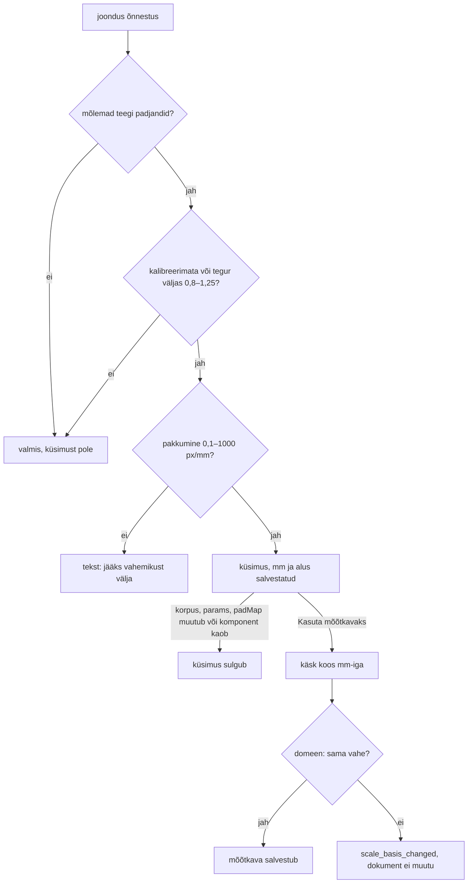

# M2-2b-7 · Mõõtkavapakkumise kehtivus, märkide kontrast ja näidisfailid

**Olek:** ehitamiseks · **Rada:** B · **Haru:** `codex/m2-2b` (tööpuu `C:/Users/TRUMPIT/.codex/worktrees/bb-m2-2b/BB`) · **Alus:** `2a083fa` · **Allikas:** [M2.2b plaan](../plans/M2-2b-korpused-ja-mootkava.md), ül. 7 ja [Astra audit](../review/2026-11-25-m2-2b-ulevaatus-2eb1a1c.md), leiud 02, 04, 06 ja 07

## Eesmärk
„Kasuta mõõtkavaks“ salvestab täpselt selle mõõtkava, mida küsimus näitas, ja ainult teadaoleva korpuse jalgadest:
- Kui korpus, parameetrid või jalgade kaart muutub või komponent kaob, küsimus sulgub. Käsk lükkab muutunud aluse tagasi (leid 02).
- Käsitsi lisatud jalgadega joondus töötab nagu praegu, aga mõõtkava ei pakuta (leid 04).
- Kui joondus õnnestus, aga pakkumine jääks lubatud vahemikust välja, ütleb tööriist seda (leid 06).
- Pluss ja triip on loetavad igal fotol mõlemas teemas (leid 07).
- Lisaks tulevad näidisfailid `v0.6.0` ja `v0.7.0` (03 § 9).

## Loe (ainult need)
Esimene viide on põhikaustas, teised loe tööpuust (`2a083fa`).
- `docs/review/2026-11-25-m2-2b-ulevaatus-2eb1a1c.md:38-73` (leiud 02, 04, 06 ja 07 koos kordusjuhtumitega)
- `packages/domain/src/rules/scale-from-pins.ts:1-75` (`pinPairInMm`, `pinSpacingMm`, `scaleFromPins`; padjandid `geometry/board.ts:89-97`)
- `packages/features/components/ui/AlignTool.ts:19-118` (`applyComponentScale` ja `alignClick`)
- `packages/features/components/ui/AlignScaleQuestion.tsx:22-57` (küsimus; `hud`-i kutse `packages/ui/src/canvas/Canvas.tsx:205-215` ja `382-383`)
- `packages/features/components/ui/layers/ComponentShape.tsx:43-85` (`Body`: kontuur, märgid, 1. jala punkt)

## Muuda
- `packages/domain/src/rules/scale-from-pins.ts`: otsused 1 ja 2.
- `packages/features/components/contract.ts`: `ScaleFromPinsSchema` väli `mm` (otsus 2).
- `packages/features/components/ui/`:
  - `align.ts`: `scaleBasisKey`;
  - `align-store.ts`: `mm` ja `basis`;
  - `AlignTool.ts`: otsused 1, 3 ja 4;
  - `AlignScaleQuestion.tsx`: otsus 3;
  - `errors.ts` ja `i18n/et.ts`: otsus 2.
- `packages/ui/src/canvas/tools.ts` ja `Canvas.tsx`: `hud`-i teine argument (otsus 3).
- `packages/features/components/ui/layers/ComponentShape.tsx`: otsus 5.
- Näidisfailid (otsus 6).
- Testid jaotisest „Tõend“. Olemasolevaid ootusi ei muudeta. Muuta võib ainult kahte sisendit ja ühte abifunktsiooni:
  - `scale_from_pins_sets_scale_and_places_component` ja `scale_from_pins_command_is_one_undo_step` saavad sisendisse `mm: 2`;
  - `interaction.test.tsx`-i `mount` saab valikulise `pxPerMm` (vaikimisi 10).
- `pnpm api` (`@pcbk/ui` ja components liides muutuvad).

## Ära puutu
- `alignByTwoPins`, joonduse piir 0,2–5, `pickHit`, `query` ja Enteri reegel M2-2b-6-st.
- Failivorming (`format_version`, skeemifail), versioon, liitmine ja sildid. Olemasolevad näidisfailid `v0.1.0`–`v0.5.0`.
- Leiud 08–14 (M2.3 plaan ja salvestuse kaart).
- Kasutaja fotod ja projektid: ainult sünteetilised andmed.

## Otsused ja liidesed
1. **Mõõtkava alus on ainult korpuse teegi padjandid** (leid 04).
   - `pinSpacingMm(board, pinA, pinB)` tagastab vahe ainult siis, kui mõlemad füüsilised padjandid tulevad korpuse geomeetriast. Käsitsi lisatud (`customPads`) või puuduva padjandi korral tagastab see `undefined`.
   - `boardPads` paneb jala korpuse padjandid enne käsitsi lisatuid. Seega on padjand teegi oma, kui `padIndex` on väiksem kui selle jala korpuse padjandite arv.
   - Joonda: kui `pinSpacingMm` on `undefined`, käib joondus nagu praegu, aga küsimust ega mõõtkava teksti ei tule. Ebaõnnestunud joonduse veateade jääb samaks.
2. **Käsk kontrollib kuvatud alust** (leid 02).
   - `ScaleFromPinsSchema` ja domeeni `scaleFromPins` sisend saavad välja `mm: z.number().positive()`, mis on küsimuses kuvatud jalgade vahe.
   - Kontrollide järjekord:
     1. komponent puudub → `RuleTargetNotFound`;
     2. `not_placed`;
     3. sama jalg või puuduv padjand → `pins_coincide`;
     4. käsitsi lisatud padjand → `RuleRejected('scale_needs_library_pads')`;
     5. `|praegune vahe − mm| > 1e-6` → `RuleRejected('scale_basis_changed')`;
     6. senine vahemiku kontroll.
   - Tagasilükatud käsk dokumenti ei muuda.
   - `commandError`:
     - `scale_basis_changed` → `alignEt.scaleBasisChanged` = „Korpus või jalad muutusid. Joonda uuesti.“;
     - `scale_needs_library_pads` → `alignEt.scaleNeedsLibraryPads` = „Mõõtkava saab võtta ainult korpuse teegi jalgadest.“
3. **Küsimus hoiab oma alust ja sulgub selle muutumisel** (leid 02).
   - `AlignScaleStage` saab kaks välja:
     - `mm: number` on küsimuse avamisel arvutatud `pinSpacingMm`;
     - `basis: string` on `scaleBasisKey(board)` = `JSON.stringify([board.footprint, board.params, board.padMap ?? null])` (`align.ts`).
   - Küsimuse „Uus mõõtkava“ arvutatakse `stage.mm` järgi ja `applyComponentScale` saadab käsule `stage.mm`. Kuvatud ja salvestatud mõõtkava on sama arv.
   - `CanvasTool` saab `hud?(api: ToolApi, snapshot: Snapshot): JSX.Element | null` ja `Canvas` annab sellele oma praeguse `snapshot`-i. Põhjus: `api.snapshot()` loeb viidet, mida `Canvas` uuendab alles efektis, nii et renderdamise ajal on see ühe sammu vana. Piiks võib argumendi kasutamata jätta.
   - `AlignScaleQuestion` saab `snapshot`-i. Küsimus ei renderdu ja efekt kutsub `reset()`, kui komponenti või selle `board`-i pole või kui `scaleBasisKey` erineb `stage.basis`-ist. Paigutuse muutus (keskpunkt, nurk, tegur) küsimust ei sulge.
   - `applyComponentScale` kontrollib sama tingimust `api.snapshot()` järgi. Kui alus muutus, kutsub see `reset()` ja käsku ei käivita.
4. **Lubamatu pakkumine saab selgituse** (leid 06).
   - Pärast õnnestunud joondust tuleb pakkumine siis, kui teegi vahe on olemas, `distance >= 5` ja foto on kalibreerimata või tegur on väljaspool 0,8–1,25:
     - pakkumine 0,1–1000 px/mm piires → küsimus nagu praegu;
     - pakkumine väljaspool → tööriist läheb sammule 1 ja näitab teksti `alignEt.scaleOutOfRange`, joondus ja selle `Ctrl+Z` jäävad alles.
   - Ebaõnnestunud joonduse haru (`scale_out_of_range`, küsimus asendab vea) jääb samaks.
5. **Plussi ja triibu alusjoon** (leid 07).
   - `Body` joonistab iga `plus` ja `band` märgi alla sama `d`-ga tee. Selle omadused on `data-mark-halo={kind}`, `fill="none"`, `stroke="var(--halo)"`, `strokeWidth={3.6}` ja `strokeLinecap="round"`; `vectorEffect` ja `strokeDasharray` on samad mis märgil.
   - Järjekord: kontuuri halo → märkide halod → kontuuri joon → märgid → 1. jala punkt. Nii ei kata märgi halo kontuuri joont. `notch` ja `tab` halo ei saa.
6. **Näidisfailid 03 § 9 järgi.**
   - Failid:
     - `apps/desktop/src-tauri/tests/fixtures/v0.6.0.pcbk` ja `packages/domain/src/__fixtures__/releases/v0.6.0.document.json`;
     - `v0.7.0.pcbk` ja `v0.7.0.document.json` samades kaustades.
   - `v0.6.0` luuakse sildi `v0.6.0` kasutajaliidesest sünteetilise fotoga ajutises tööpuus `%TEMP%\bb-m2-2b-7\v0.6.0-worktree` (`git worktree add --detach … v0.6.0`), nagu [M2-2-11](M2-2-11.md) tegi `v0.5.0`-ga. Hiljem eemaldatakse ajutine tööpuu. `v0.7.0` luuakse selle haru koodiga.
   - Mõlemas on R1 ja U1 (SOIC-8, jala 3 nimi „FB“, jalg 8 NC), sest seda kontrollivad olemasolevad üldtestid.
   - `v0.6.0`: kalibreering ja kaks Piiksu läbivust (üks piiksub ja ühendab, teine ei piiksu). Lisaks ühendus ja võrk rolliga `kind: 'ground'`.
   - `v0.7.0`: mõõtkava „Kasuta mõõtkavaks“ kaudu U1 jalgadest 1 ja 4 (3,81 mm), radiaalne elektrolüüt C1 (ümar, pluss ja triip) ning U1 sälk.
   - Dokumendi JSON võetakse sama `.pcbk` faili dokumendist. Haru failis on `app_version` `0.6.0`, sest versioon tõuseb liitmisel. Suurus ja SHA-256 lähevad üleandmisse.

## Tõend
- TS:
  - `scale_from_pins_rejects_changed_basis_and_own_pads` (`packages/domain/src/rules/scale-from-pins.test.ts`): R1 on 0805 nagu senises testis, sihid (200, 200) ja (200, 240). Kui R1 `params` on enne käsku `{ size: '1206' }` ja sisend on endiselt `mm: 2`, visatakse `scale_basis_changed` ja dokument ei muutu. Komponendil `footprint: 'area'` on käsitsi padjandid `'1'` (−2; 0) ja `'2'` (2; 0) mm (`sizeMm: 1`, `circle`, `through: false`). `pinSpacingMm` annab `undefined`, `scaleFromPins` `mm: 4`-ga viskab `scale_needs_library_pads` ja dokument ei muutu.
  - `scale_question_closes_when_basis_changes` (`packages/features/components/ui/layers/interaction.test.tsx`): iga alamjuhtum algab eraldi `mount()`-iga (0805, 10 px/mm, kalibreeritud). Pärast seda `beginAlignment` ja klõps (180, 160): joondus rakendub ja küsimus näitab „Uus mõõtkava: 20,00 px/mm“. `act`-is `components.rotate` `{ ids: [id], deltaDeg: 90 }` jätab küsimuse ja sama teksti; „Kasuta mõõtkavaks“ kutsub `components.scaleFromPins`-i `mm: 2`-ga ja mõõtkava on 20. `act`-is `components.changeFootprint` `{ id, footprint: 'chip', params: { size: '1206' }, newPinUids: {} }` sulgeb küsimuse; `Enter` stseeni `svg`-l ei kutsu `components.scaleFromPins`-i ja mõõtkava jääb 10-ks. `act`-is `items.delete` `{ ids: [id] }` sulgeb küsimuse ja veateadet ei tule.
  - `align_own_pins_offer_no_scale_question` (`interaction.test.tsx`): `mount({ footprint: 'area', params: {}, center: (170, 100), customPads }, 1, 'none', false)`; `customPads` jaoks on `'1'` (−2; 0) ja `'2'` (2; 0) mm, `sizeMm: 1`, `circle`. Jalg 1 (150, 100) läheb sihti (300, 300) ja jalg 2 (190, 100) sihti (380, 300). `components.align` rakendub üks kord. Küsimust ega veateadet pole. `components.scaleFromPins`-i ei kutsuta. Mõõtkava jääb 10 px/mm ja `calibrated: false`.
  - `align_out_of_range_proposal_explains_and_keeps_alignment` (`interaction.test.tsx`): `pxPerMm: 800`, suum 0,1, 0805 keskpunkt (1000, 1000), jalad maailmas (200, 1000) ja (1800, 1000). Ekraaniklõpsud: jalg 1 (20, 100) → siht (50, 300) ja jalg 2 (180, 100) → siht (290, 300). Joondus rakendub (`rev` + 1, `scaleX` ≈ 1,5), küsimust pole, tekst „Selle korpuse järgi jääks mõõtkava lubatud vahemikust (0,1–1000 px/mm) välja.“ on nähtav ja mõõtkava on 800. `engine.undo()` taastab keskpunkti (1000, 1000) ja `scaleX: 1`.
  - `component_marks_have_halo_underlay` (`packages/features/components/ui/layers/body-marks.test.tsx`): andmed on samad mis `body_marks_draw_on_canvas`-is. C1 `[data-mark="plus"]` ja `[data-mark="band"]` all on kummalgi üks `[data-mark-halo]` sama `d`-ga, `stroke="var(--halo)"`, `stroke-width="3.6"` ja `fill="none"`. Dokumendi järjekord on kontuuri halo polügon, märkide halod, kontuuri joone polügon, märgid. SOIC-il pole ühtegi `[data-mark-halo]`-d.
  - `release_documents_v060_v070_keep_their_content` (`packages/domain/src/release-files.test.ts`): kontroll tehakse pärast `migrateDoc`-i, `BoardDocSchema.parse`-i ja `validateDocument`-i. `v0.6.0`-s on vähemalt kaks mõõtmist `mode: 'continuity'` ja `source: 'beep_mode'`, üks `beep: true` ja üks `beep: false`. Seal on ka vähemalt üks ühendus `basis: 'assumed'` ja `roles`-is roll `kind: 'ground'`. `v0.7.0`-s on `scale.calibrated` `true` ja `scale.calib.mm` 3,81 ± 0,001. C1 `board.footprint` on `'radial'` ja U1 oma `'soic'`.
- Ekraanipildid `output/playwright/m2-2b-7/`: radiaal D 6,3 20 px/mm juures heledas ja tumedas teemas, kumbki valge ja musta sünteetilise foto peal (4 pilti). Failinimed lähevad üleandmisse.
- Rada B täisring: põhikaustast `pnpm bb-review-card M2-2b-7` (koos `cargo test`-iga) → `ok: true`, `missing: []`.
  - `every_release_pcbk_opens_without_modifying_source` avab ka uued failid.
  - `every_release_document_migrates_and_validates`, `scale_from_footprint_end_to_end`, `align_enter_on_other_button_keeps_scale` ja `align_question_replaces_out_of_range_error` läbivad muutmata.

## Valmis kui
- [ ] Testid ja täisring läbivad.
- [ ] Muudetud on ainult jaotises „Muuda“ nimetatud sisendid ja `mount`-i parameeter, olemasolevad ootused on samad.
- [ ] Näidisfailid on lisatud, suurus ja SHA-256 on üleandmises ning ajutine `v0.6.0` tööpuu on eemaldatud.
- [ ] `docs/api` on uuendatud.
- [ ] Üleandmine on allpool, kuni 20 rida.

## Üleandmine
