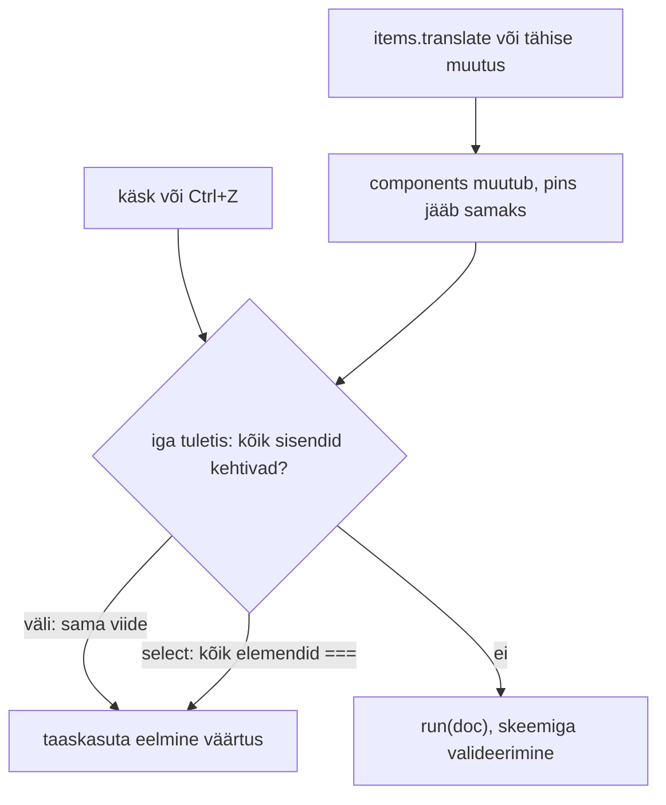

# M2-3-1 · Moodulite piirid ja tuletised

**Olek:** ehitamiseks · **Rada:** B · **Haru:** `codex/m2-3` (uus tööpuu `C:/Users/TRUMPIT/.codex/worktrees/bb-m2-3/BB`, tehakse `main`-ist pärast selle kaardi commit'i) · **Alus:** `main` · **Plaan:** [M2.3 › Ülesanne 1](../plans/M2-3-skeemi-sumbolid-ja-paigutus.md) ja [Astra M2.2b audit](../review/2026-11-25-m2-2b-ulevaatus-2eb1a1c.md), leiud 09–12

## Eesmärk
Enne mooduli `schematic` lisamist on moodulite piirid ja tuletised korras:
- iga lubatud `@pcbk/features/*` alamtee laheneb (leid 09);
- sõltuvuskontroll leiab ka kaudse tee UI → mooduli juurkausta fail → mootor (leid 11);
- tuletis loeb ainult dokumenti, mitte teisi tuletisi (leid 10);
- `measurements` deklareerib sõltuvuse `connections`-ist, mida Piiksu kaitse kinnitus vajab (leid 12);
- komponendi liigutus (plaadil, hiljem ka skeemil) ega tähise muutmine ei arvuta uuesti `nets`-i ja `connectionLevels`-i. M2-2-11 mõõtis nende ajaks 17–20 ms (eelarve 16 ms).

## Loe (ainult need)
- `docs/review/2026-11-25-m2-2b-ulevaatus-2eb1a1c.md:80-102` (leiud 09–12 koos kordusjuhtumitega)
- `packages/engine/src/derivation.ts:21-37` (vahemälu reegel; `DeriveSpec` on `types.ts:22-30`, registri kontroll `registry.ts:64-69`)
- `packages/features/nets/engine/derive.ts:1-15` (sisend; sama `connections/engine/derive.ts:1-12`; komponendist loetakse ainult `id`, `kind` ja `pins`: `domain/src/rules/net-info.ts:52-75`, `levels.ts:15`)
- `.dependency-cruiser.cjs:49-53` (`feature-ui-not-engine`; test `tooling/feature-deps.test.ts:16-75`, fixture `tooling/fixtures/feature-deps/`)
- `tooling/api-digest.mjs:93-108` (moodulite sisenemised; muster `packages/features/package.json:6-13`)

## Muuda
- `packages/engine/src/types.ts`, `derivation.ts`, `registry.ts` ja `index.ts`: otsus 1.
- `packages/domain/src/rules/`: `componentTopology` (otsus 2), eksport `@pcbk/domain/rules` kaudu.
- `packages/features/nets/engine/derive.ts` ja `packages/features/connections/engine/derive.ts`: otsus 2.
- `packages/features/measurements/engine/index.ts`: otsus 3.
- `packages/features/nets/ui/index.ts` → `index.tsx` (`git mv`, sisu ei muutu) ja `tooling/api-digest.mjs`: otsus 4.
- `.dependency-cruiser.cjs` ja fixture `tooling/fixtures/feature-deps/`: otsus 5.
- `docs/03-arhitektuur.md` § 7.4: kaks lauset otsustest 1 ja 2.
- Testid jaotisest „Tõend“. Olemasolevaid ootusi ei muudeta.
- `pnpm api` (`@pcbk/engine` ja `@pcbk/domain` liides muutub).

## Ära puutu
- Moodul `schematic`, skeemivaade ja sümbolid (kaardid M2-3-2…M2-3-5).
- Tauri jõudlusproov (leid 08, kaart M2-3-6) ja korpuse kontuuri kirjutuskaitse (leid 14, kaart M2-3-3).
- Failivorming, Rusti kood, versioon, liitmine ja sildid.
- Tuletiste tulemuste sisu: `nets`, `connectionLevels`, `pinReadings` ja paigutamata loendid annavad samast dokumendist sama tulemuse mis enne.
- Kasutaja fotod ja projektid: ainult sünteetilised andmed.

## Otsused ja liidesed
1. **Tuletis loeb ainult dokumenti ja võib sisendit kitsendada** (leid 10).
   - `DeriveSpec.run(doc: DeepReadonly<BoardDoc>): Derived[Key]`. Teist argumenti (`derived`) enam pole ja `createSnapshotBuilder` kutsub `run`-i ühe argumendiga.
   - Uus avalik tüüp: `export type DeriveInput = DocKey | { key: DocKey; select(doc: DeepReadonly<BoardDoc>): readonly unknown[] }`. `DeriveSpec.inputs` on `DeriveInput[]`.
   - Vahemälu reegel sama seansi eelmise hetktõmmise suhtes:
     - välja nimega sisend kehtib nagu praegu (`previous.doc[key] === doc[key]`);
     - `{ key, select }` sisend kehtib, kui välja viide on sama või kui `select(previous.doc)` ja `select(doc)` on sama pikkusega ja iga element on `===`.
   - Väärtus taaskasutatakse ainult siis, kui kõik sisendid kehtivad. Eelmise dokumendi projektsiooni võib hoida vahemälus, et seda ei arvutataks kaks korda.
   - Register kontrollib `{ key, select }` sisendi `key`-d sama `checkField`-iga.
2. **Võrgud ja tasemed sõltuvad jalgade topoloogiast** (M2.2 plaani järgmine töö).
   - `export function componentTopology(components: readonly Component[]): readonly unknown[]` tagastab lameda massiivi `[id, kind, pins, id, kind, pins, …]` dokumendi järjekorras. `pins` on sama massiivi viide, mitte koopia.
   - `nets` ja `connectionLevels` kasutavad `'components'` asemel `{ key: 'components', select: (doc) => componentTopology(doc.components) }`. Teised sisendid jäävad samaks.
   - Seega ei arvuta liigutus (`board` või hiljem `schematic` muutub) ega tähise, märgistuse või väärtuse muutmine võrke uuesti. Jala lisamine, eemaldamine, ümbernimetamine, NC ja tüübi muutus arvutavad.
3. **Piiksu kinnituse sõltuvus** (leid 12). `measurementsEngine.dependsOn` = `['components', 'connections']`, nagu 05 moodulite kaart juba näitab. Ilma `connections` moodulita annab register `RegistryError('Missing module dependency: connections')`, mitte hilisema `not_found`-i.
4. **Avalikud alamteed lahenevad** (leid 09).
   - `nets/ui/index.ts` saab nimeks `index.tsx`, nii et muster `./*/ui` → `./*/ui/index.tsx` kehtib kõigile moodulitele.
   - `api-digest.mjs` viskab vea `Puudub avalik sisenemine: packages/features/<moodul>/<osa>`, kui moodulil on kaust `ui/` või `engine/`, aga oodatud sisenemisfaili pole. Varem jättis see mooduli vaikselt vahele.
5. **Mooduli juurkaust ei impordi mootorit** (leid 11).
   - Uus reegel `feature-root-no-engine`:
     - `from`: `^packages/features/[^/]+/(?!engine/|ui/)` (juurfailid ja muud alamkaustad, nt `contract.ts`, `contract/`, `transform.ts`), testid välja arvatud;
     - `to`: `^packages/(?:engine|adapters)/` või `^packages/features/[^/]+/engine/`;
     - tüübiviited on lubatud (`dependencyTypesNot: ['type-only']`).
   - Nii on kaudne tee UI → juurfail → mootor keelatud juurfaili sammul. Praegu ükski juurfail mootorit ei impordi, seega tootekoodis rikkumisi ei teki.

## Tõend
- TS:
  - `derive_select_reuses_unchanged_projection` (`packages/engine/src/derivation.test.ts`): sama ülesehitus nagu `derive_reuses_value_when_inputs_unchanged`, sisend `{ key: 'components', select: (doc) => doc.components.map(({ pins }) => pins) }`. Tähise muutus `R1` → `R2` ei kutsu `run`-i uuesti ja tuletis on sama viide (`toBe`). Jala lisamine kutsub `run`-i ning `Ctrl+Z` ja `redo` annavad õige väärtuse. Iga `run`-i kutse on ühe argumendiga.
  - `nets_and_levels_skip_component_moves` (`packages/features/__tests__/derived-topology.test.ts`, uus): `setup(doc)` kõigi moodulitega, R1 (0805) ja U1 (SOIC-8) plaadil, ühendus R1.2 → U1.3. `items.translate` R1-le ja `components.update` `ref: 'R5'` jätavad `derived.nets` ja `derived.connectionLevels` samaks viiteks. `components.setNc` U1 jalale 8 ja R1 tüübi muutus annavad `nets`-ile uue viite.
  - `incremental_derived_equals_full_rebuild` (`derived-topology.test.ts`): sammud `connections.add`, `items.translate`, `components.update` (tähis), `components.setNc`, `beep.record`, `Ctrl+Z`, `Ctrl+Z` ja `redo`. Iga sammu järel võrdub `engine.snapshot().derived` (`toEqual`) uue mootoriga, mis on loodud sama dokumendi koopiast (`setup(structuredClone(doc))`).
  - `measurements_requires_connections_module` (`packages/features/composition.test.ts`): `buildRegistry` ilma `connectionsEngine`-ita (selle väljad `reserved`-is) viskab `RegistryError`-i teatega `Missing module dependency: connections`. Täiskooste registreerub.
  - `feature_ui_cannot_reach_engine_through_module_root` (`tooling/feature-deps.test.ts`): fixture `demo/ui/control.ts` impordib mootorit otse ja `demo/ui/probe.ts` → `demo/glue.ts` → mootor. Tegeliku `ruleSet`-iga annab `cruise` rikkumised `feature-ui-not-engine` (`control.ts`) ja `feature-root-no-engine` (`glue.ts`).
  - `every_feature_subpath_resolves` (`tooling/feature-exports.test.ts`, uus): iga `packages/features/<moodul>` puhul, millel on `contract.ts`, `engine/` või `ui/`, laheneb `createRequire(packages/features/package.json).resolve('@pcbk/features/<moodul>/<osa>')` olemasolevaks failiks. Loendis on ka `nets/ui`.
- Mõõtmine: sünteetiline plaat seemnega 127 (`apps/desktop/src/perf/synthetic-board.ts`, sama mis M2-2-11). Mõõda 20 `items.translate` käsu kestuse mediaan Node'is enne (`main`) ja pärast. Tulemus läheb üleandmisse, mitte testi.
- Rada B täisring: põhikaustast `pnpm bb-review-card M2-3-1` (koos `cargo test`-iga) → `ok: true`, `missing: []`. `pnpm check` depcruise annab 0 rikkumist ja `pnpm api:check` läbib.

## Valmis kui
- [ ] Testid ja täisring läbivad, olemasolevad ootused on samad.
- [ ] `derived`-i tulemused on samast dokumendist samad mis enne; mõõtmise tulemus on üleandmises.
- [ ] `docs/api` ja 03 § 7.4 on uuendatud.
- [ ] Üleandmine on allpool, kuni 20 rida.

## Üleandmine
