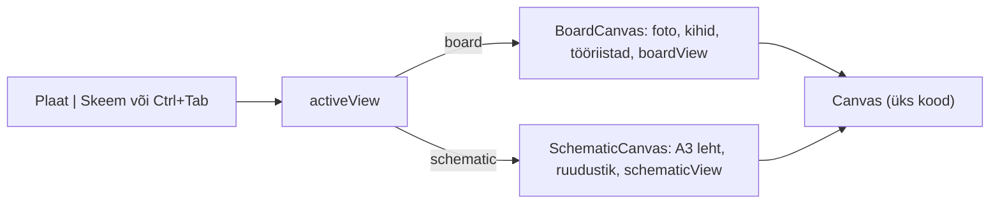

# M2-3-2 · Skeemivaade ühe lõuendiga

**Olek:** vastu võetud `cbd4d42` · **Rada:** A · **Haru:** `codex/m2-3` (tööpuu `C:/Users/TRUMPIT/.codex/worktrees/bb-m2-3/BB`) · **Alus:** `e1a8ac5` · **Plaan:** [M2.3 › Ülesanne 2](../plans/M2-3-skeemi-sumbolid-ja-paigutus.md) (otsused 1 ja 5, O3)

## Eesmärk
Ülaribal on lüliti „Plaat | Skeem“ ja `Ctrl+Tab`. Skeem avaneb A3 rõhtse lehena 2,54 mm ruudustikuga sama `Canvas`-i peal: pan, suum, „Sobita“ ja valik töötavad nagu plaadil. Kummalgi vaatel on oma suum ja asukoht ning vahetamisel need säilivad. Tühi skeem ütleb, et komponente pole veel. Sümbolid ja komponendid tulevad kaartidega M2-3-3…M2-3-5.

## Loe (ainult need)
- `packages/ui/src/app/Workbench.tsx:22-61` (`BoardCanvas`: kuidas `Canvas` kokku pannakse)
- `packages/ui/src/shell/view-store.ts:34-104` (`boardView`, `restore`, `getView`, `reset`)
- `packages/contracts/src/view-state.ts:1-80` (`ViewState`-i vaikeväärtus ja lugemine; tüüp `project-service.ts:12-23`)
- `packages/ui/src/shell/keymap.ts:13-99` (`SHELL_KEYS` ja `bindPanelKeys`; ülariba `TopBar.tsx:52-117`)
- `packages/ui/src/shell/ViewControls.tsx:1-39` (suumi protsent ja kursori näit; pinna joonistus `canvas/Canvas.tsx:361-370`)

## Muuda
- `packages/contracts/src/project-service.ts` ja `view-state.ts`: otsus 2.
- `packages/ui/src/shell/view-store.ts`: otsus 2.
- `packages/ui/src/shell/UiRegistry.ts`: `schematicLayers` (otsus 1).
- `packages/ui/src/app/SchematicCanvas.tsx` (uus) ja `Workbench.tsx`: otsused 1 ja 3.
- `packages/ui/src/shell/TopBar.tsx`, `keymap.ts` ja `ViewControls.tsx`: otsus 4.
- `packages/ui/src/shell/i18n/et.ts` ja shelli CSS: tekstid ja stiil.
- Testid jaotisest „Tõend“. Olemasolevaid ootusi ei muudeta.
- `pnpm api` (`@pcbk/ui` ja `@pcbk/contracts` liides muutub).

## Ära puutu
- Domeen, mootor, moodulid (`packages/features`), dokumendi vorming ja käsud.
- `BoardCanvas`-i käitumine: plaadi kihid, tööriistad, klahvid, kontekstimenüü ja raamvalik jäävad samaks.
- Moodulite klahvid, tööriistad, kontekstimenüü, liigutamine, raamvalik ja kustutamine skeemivaates (kaart M2-3-4). Skeemi `Canvas` ei saa neid praegu üldse.
- Kasutaja fotod ja projektid: ainult sünteetilised andmed.

## Otsused ja liidesed
1. **Sama `Canvas`, teised propsid.**
   - `UiModule` saab valikulise pesa `schematicLayers?: LayerSpec[]` ja `UiRegistry` meetodi `schematicLayers(): LayerSpec[]`. Kopeerimine ja id-de kontroll käivad samamoodi nagu `canvasLayers`-il. Praegu ükski moodul seda ei täida.
   - `SchematicCanvas` renderdab sama `Canvas`-i järgmiste propsidega:
     - `layers` = ruudustiku kiht + `registry.schematicLayers()`;
     - `tools` = `[]` (vali ja pan on lõuendis sees);
     - `sceneTransform` = `'none'`;
     - `surface` = `{ width: 420, height: 297 }` (mm);
     - `view` = `schematicView` ja `onViewChange` = `setSchematicView`;
     - `fitInsets` nagu plaadil;
     - `keys`, `contextMenu`, `moveRefs`, `itemsInFrame` ja `deleteIds` jäävad andmata.
   - `Workbench` annab `AppShell`-ile `activeView === 'schematic'` korral `SchematicCanvas`-i, muidu `BoardCanvas`-i. Paneelid jäävad samaks.
2. **Vaate olek.**
   - `ViewState` saab valikulise välja `schematicView?: BoardView`.
     - `parseViewState` võtab selle `normalizeBoardView`-i reeglite järgi. Puuduv või vigane väärtus jääb puudu ega muuda ülejäänud vaadet kehtetuks.
     - Vaikeolekus `schematicView`-i pole.
     - Vana fail ilma selle väljata avaneb nagu enne.
   - `useViewStore` saab:
     - `activeView: 'board' | 'schematic'`, mida ei salvestata ja mis on avamisel ja `reset`-il `'board'`;
     - `schematicView: BoardView | null`, kus `null` tähendab, et skeemi pole veel avatud;
     - `setActiveView(view)`, `toggleView()` ja `setSchematicView(view)`.
   - `restore` võtab `schematicView`-i salvestatud vaatest. `getView` lisab selle ainult siis, kui see pole `null`.
   - Kui `SchematicCanvas` paigaldub ja `schematicView` on `null`, kutsub see `requestFit()`. Leht sobitub ekraanile ja esimene vaate muutus salvestab `schematicView`-i.
3. **Ruudustik ja tühi skeem.**
   - Ruudustiku kiht joonistab lehe sisse SVG `pattern`-iga peened jooned iga 2,54 mm järel ja tugevad jooned iga 25,4 mm järel. Peened jooned on nähtavad ainult siis, kui `2,54 × zoom ≥ 6` px. Kiht ei võta tabamust (`pointerEvents="none"`).
   - Kui ühelgi komponendil pole `schematic`-paigutust, näitab skeem lõuendi nurgas teksti „Skeemil pole veel komponente.“ (`
`, ei võta hiirt). Sellel pole rolli `status`.
4. **Lüliti, klahv ja vaate juhtnupud.**
   - `TopBar`-i tegevuste algusesse tuleb nupupaar `role="group"` `aria-label="Vaade"`: „Plaat“ ja „Skeem“, aktiivsel `aria-pressed="true"`. Vihje on „Plaat | Skeem · Ctrl+Tab“.
   - `SHELL_KEYS.view` = `{ key: 'Tab', primary: true, shift: 'any' }`. Seda käsitletakse samade reeglitega nagu `N`/`O` (mitte tekstiväljas ega dialoogis). Klahv kutsub `toggleView()`-d ja `preventDefault()`-i. Veebibrauser võib `Ctrl+Tab`-i enda jaoks võtta, aga nupp töötab alati.
   - `ViewControls`:
     - suumi protsent tuleb aktiivse vaate suumist; skeemil on 100 % = 1 mm 96 dpi järgi (`zoom / (96 / 25,4)`);
     - skeemil näitab kursori näit maailma koordinaate otse millimeetrites, plaadil jagab see nagu praegu `pxPerMm`-iga;
     - „Sobita“, „−“ ja „+“ toimivad aktiivsele vaatele, sest korraga on paigaldatud ainult üks `Canvas`.
   - Tekstid `et.ts`-is: `view: 'Vaade'`, `viewBoard: 'Plaat'`, `viewSchematic: 'Skeem'`, `schematicEmpty: 'Skeemil pole veel komponente.'`.

## Tõend
- TS:
  - `view_state_keeps_schematic_view` (`packages/contracts/src/view-state.test.ts`): kehtiv `schematicView` `{ zoom: 3,2, pan: (−40; 12) }` tuleb `parseViewState`-ist tagasi. `{ zoom: 0 }` ja puuduv väli jätavad `schematicView`-i puudu, ülejäänud vaade on kehtiv. `sameViewState` eristab kahte olekut, mis erinevad ainult `schematicView`-i poolest.
  - `schematic_canvas_reuses_canvas_with_own_view` (`packages/ui/src/app/schematic-canvas.test.tsx`, uus): hetktõmmises on foto ja R1 plaadil ning `schematicView` on `null`. `SchematicCanvas`-i `svg`-s on `[data-view]` ja `[data-scene]` ning leht 420 × 297. Ruudustiku `pattern` on 2,54 suurune, fotot (`image`) ja komponendi kihte pole. Tekst „Skeemil pole veel komponente.“ on nähtav ja paigaldus suurendas `fitRequest`-i. Rattasuum `svg`-l muudab `schematicView`-i ja `boardView` jääb samaks. Suumil 1 peened ruudustiku jooned puuduvad, suumil 4 on olemas.
  - `view_switch_key_and_controls_follow_active_view` (`packages/ui/src/shell/view-switch.test.tsx`, uus): `Ctrl+Tab` ja `Ctrl+Shift+Tab` vahetavad `activeView`-i ja kutsuvad `preventDefault()`-i. Pelgalt `Tab`, fookus tekstiväljal ja avatud dialoog vaadet ei vaheta. `ViewControls` näitab plaadi suumil 2 „200 %“ ja skeemi suumil 3,7795 „100 %“. Skeemil on kursori näit (25,4; 12,7) mm ka siis, kui `pxPerMm` on 10.
- E2e:
  - `schematic_view_switch_keeps_each_view` (`apps/web/e2e/m2-3-schematic.spec.ts`, uus): sünteetiline projekt fotoga. Plaadil vajutatakse „+“ kaks korda ja protsent jäetakse meelde. `Ctrl+Tab` avab skeemi: „Skeem“ on `aria-pressed="true"`, leht ja tekst „Skeemil pole veel komponente.“ on nähtavad ja fotot pole. Skeemil vajutatakse „+“ üks kord ja protsent jäetakse meelde. Nupp „Plaat“ taastab plaadi protsendi ja foto. Uus `Ctrl+Tab` taastab skeemi protsendi.
- Rada A: põhikaustast `pnpm bb-review-card M2-3-2` → `ok: true`, `missing: []`.

## Valmis kui
- [x] Testid läbivad, olemasolevad ootused on samad.
- [x] Ekraanipildid `output/playwright/m2-3-2/schematic-light.png` ja `schematic-dark.png` (tühi skeem suumiga „Sobita“) on üleandmises.
- [x] `docs/api` on uuendatud.
- [x] Üleandmine on allpool, kuni 25 rida, koos otsuste kaardi ja failidega väljaspool „Muuda“-loendit; commit'i sõnumi mustand on `output/commit-msg/M2-3-2.txt` ([kaartide reeglid 9–10](README.md#reeglid)).

## Arhitekti vastus ehitajale (2026-11-27)

- **Küsimus:** `same-view-state.test.ts` ja `project-view-fields.test.ts` kasutavad tüüpi `Required<ViewState>`. Valikulise `schematicView`-iga muutuks väli neis kohustuslikuks, aga vaikeolekus peab see puuduma.
- **Vastus:** luban neis kahes failis asendada ainult neli tüübimärgendit kujuga `Required<Omit<ViewState, 'schematicView'>>`. Katseandmed, võtmete võrdlus ja ootused jäävad samaks.
  - Mõlemad testid kontrollivad, et iga alati olemas olev väli salvestub ja eristub. Valikuline `schematicView` jääb nendest välja; selle lugemist ja võrdlust katab `view_state_keeps_schematic_view`.
  - Teisi olemasolevaid teste see luba ei hõlma.

## Üleandmine

- Tööpuu `C:/Users/TRUMPIT/.codex/worktrees/bb-m2-3/BB`, haru `codex/m2-3`, alus `e1a8ac5`. Algseis oli puhas.
- Neli kaarditesti andsid alusel RED-i. Tööpuu `output/playwright/m2-3-2/` logid `view-state-red.log`, `schematic-canvas-red.log`, `view-switch-red.log` ja `schematic-e2e-red.log`.
- Otsus 1 → `packages/ui/src/shell/UiRegistry.ts:268`, `packages/ui/src/app/SchematicCanvas.tsx:46`, `packages/ui/src/app/Workbench.tsx:132`.
- Otsus 2 → `packages/contracts/src/project-service.ts:21`, `packages/contracts/src/view-state.ts:58`, `packages/ui/src/shell/view-store.ts:41`, `packages/ui/src/app/SchematicCanvas.tsx:57`.
- Otsus 3 → `packages/ui/src/app/SchematicCanvas.tsx:33` (ruudustik) ja `packages/ui/src/app/SchematicCanvas.tsx:75` (tühja skeemi teade).
- Otsus 4 → `packages/ui/src/shell/TopBar.tsx:74`, `packages/ui/src/shell/keymap.ts:88`, `packages/ui/src/shell/ViewControls.tsx:9`.
- `git diff --stat` ja uute failide loend annavad 19 tööpuufaili. Kaks faili on väljaspool „Muuda“-loendit. „Ära puutu“-loendi tootmiskood, dokumendivorming ja käsud säilisid.
- `packages/contracts/src/same-view-state.test.ts` ja `packages/engine/src/project-view-fields.test.ts` said kumbki kaks kinnitatud tüübimärgendit `Required<Omit<ViewState, 'schematicView'>>`, sest valikuline väli puudub vaikeolekus. Katseandmed, võtmete võrdlus ja ootused säilisid.
- Sünteetiline tühi skeem pärast „Sobita“ vajutamist, 1440 × 900 ja 64 %. Tööpuu `output/playwright/m2-3-2/schematic-light.png` ja `output/playwright/m2-3-2/schematic-dark.png`.
- `pnpm api` uuendas `docs/api/contracts.md` ja `docs/api/ui-shell-state.md`. `pnpm api:check` läbis ja sõltuvuskontroll leidis 0 rikkumist.
- Põhikausta `pnpm bb-review-card M2-3-2` andis `ok: true`, `missing: []`. Läbis 1761 Vitesti ja 47 E2E testi.
- Raport `output/review-card/M2-3-2-aK5L5w/summary.json` ja commit’i sõnumi mustand `output/commit-msg/M2-3-2.txt` on põhikaustas.

## Arhitekti ülevaatus (2026-11-27)

- **Kontrollisin:**
  - tööpuu `git status`: 15 muudetud ja 4 uut faili, tipp `e1a8ac5`;
  - põhifailide diffi otsuste kaardi ridade järgi;
  - raportit `M2-3-2-aK5L5w`. See on uuem kui tööpuu viimane fail, seega kontrolle uuesti ei käivitanud. Tulemus: `ok: true`, `missing: []`, neli nõutud testi läbisid, kokku 1761 Vitesti ja 47 E2E.
- **Otsus 1:**
  - `schematicLayers` kopeeritakse ja id-d kontrollitakse nagu `canvasLayers`-il.
  - `SchematicCanvas` annab `Canvas`-ile ruudustiku ja moodulikihid, tööriistu ei anta. Lisaks `sceneTransform="none"`, pind 420 × 297 ja plaadiga sama `fitInsets`.
  - Klahve, kontekstimenüüd, liigutamist, raamvalikut ega kustutamist ei anta.
  - `Workbench` vahetab ainult lõuendi.
- **Otsus 2:**
  - `parseViewState` võtab `schematicView`-i ainult kehtivana ja ülejäänud vaade jääb kehtivaks. Vaikeolekus seda välja pole.
  - `restore` paneb `activeView = 'board'`.
  - `getView` lisab `schematicView`-i ainult siis, kui see pole `null`.
  - `reset` tühjendab mõlemad.
- **Otsus 3:**
  - Peen 2,54 mm ruudustik joonistub ainult siis, kui `2,54 × zoom ≥ 6`. Tugev ruudustik on 25,4 mm.
  - Kiht on `pointerEvents="none"`.
  - Teade on `
`, ilma rollita ja `pointer-events: none`.
- **Otsus 4:**
  - Nupupaar on `role="group"`, aktiivsel nupul `aria-pressed` ja vihje on „Plaat | Skeem · Ctrl+Tab“.
  - `Ctrl+Tab` käib läbi `bindPanelKeys`-i samade välistustega nagu `N`/`O`.
  - Skeemi suumi protsent on `zoom / (96 / 25,4)` ja kursori näit on otse millimeetrites.
- **Mehaanilised testimuudatused:** kahes testifailis muutusid ainult neli lubatud tüübimärgendit. Andmed ja ootused on samad.
- **Ekraanipildid** (vaatasin ise):
  - mõlemas teemas on A3 leht sobitatud, suum 64 %;
  - peen ja tugev ruudustik on nähtavad;
  - „Skeem“ on aktiivne;
  - teade on lõuendi ülanurgas;
  - fotot ega komponente pole.
- **Otsus: sobib.**
- Mitteblokeerivad märkused:
  - `keymap.ts` impordib vaate vahetuseks poe otse, kuigi `N`/`O` käivad `actions`-i kaudu. See töötab; ühtlusta, kui `bindPanelKeys` järgmine kord muutub.
  - Üleandmise rida „kaks faili väljaspool Muuda-loendit“ ei nimetanud faile. Need olid järgmisel real: kaks tüübimuudatusega testi.
  - Lisasin `output/commit-msg/` faili `.gitignore`.
