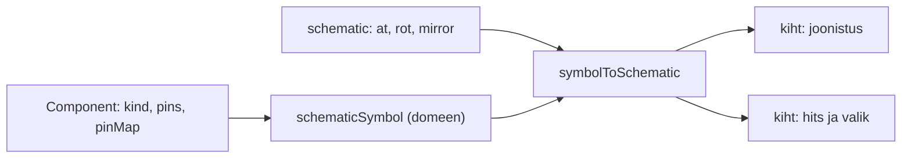

# M2-3-3 · Sümbolite teek

**Olek:** vastu võetud `8155d6e` · **Rada:** A · **Haru:** `codex/m2-3` (tööpuu `C:/Users/TRUMPIT/.codex/worktrees/bb-m2-3/BB`) · **Alus:** `cbd4d42` · **Plaan:** [M2.3 › Ülesanne 3](../plans/M2-3-skeemi-sumbolid-ja-paigutus.md) (otsused 2 ja 3, O2, O4, O5, leid 14)

## Eesmärk
Skeemipaigutusega komponent joonistub skeemil IEC sümbolina. Joonistus ja tabamus tulevad samast domeenifunktsioonist. Kui jalgade nimed ei anna sümboli kontakte üheselt, on komponent nummerdatud kast. Korpuse kontuuri ja sümbolit ei saa tarbija muuta (leid 14). Skeemile paigutamise käsud tulevad kaardiga M2-3-5; siin kontrollitakse sümboleid sünteetilise projektiga.

## Loe (ainult need)
- `packages/domain/src/model/component.ts:5-81` (23 tüüpi, `Pin`, `SymbolPlacement`)
- `packages/domain/src/footprints/body-outline.ts:60-76` (leid 14: jagatud vahemälu)
- `packages/ui/src/canvas/tools.ts:48-55` (`LayerSpec.render` ja `hits`; `HitItem` failis `hit-index.ts:5-25`)
- `packages/features/composition.ts:1-22` (moodulipaar; koosteloendid `features/engine.ts` ja `features/ui.ts`)
- `apps/web/e2e/m2-2-beep.spec.ts:55-110` (sünteetilise projekti külvamine IndexedDB-sse)

## Muuda
- `packages/domain/src/schematic/` (uus) ja `package.json`-i alamtee `./schematic`: otsused 1 ja 2. Jaga failideks, kui fail ületab 400 rida.
- `packages/domain/src/footprints/body-outline.ts`: otsus 4.
- `packages/features/schematic/engine/index.ts` ja `ui/index.tsx` (uued) koos sümbolikihiga; `features/engine.ts` ja `features/ui.ts`: otsus 3.
- Testid jaotisest „Tõend“; `pnpm api`.

## Ära puutu
- Käsud, dokumendi vorming, moodul `components`, `BoardCanvas` ja `SchematicCanvas`. Mootorimoodulil `schematic` pole veel käske ega andmeid.
- Salvestatud `schematic.symbol` ei mõjuta M2.3-s joonistust; sümbol tuleb alati tüübist.

## Otsused ja liidesed
1. **Domeen** (`@pcbk/domain/schematic`):
   - `SCHEMATIC_GRID_MM = 2.54`.
   - `SymbolId` = `'resistor' | 'capacitor' | 'capacitor_polarized' | 'inductor' | 'diode' | 'led' | 'zener' | 'npn' | 'pnp' | 'nmos' | 'pmos' | 'crystal' | 'switch' | 'fuse' | 'terminal' | 'box'`.
   - `SymbolPrim` = `{ kind: 'line'; points; closed?; fill? } | { kind: 'circle'; at; r; fill? } | { kind: 'text'; at; text; size; anchor: 'start' | 'middle' | 'end' }`, mõõdud millimeetrites.
   - `SymbolPin` = `{ contact; pinId; end; inner }`. `end` on ühenduspunkt ruudustikul, `inner` on koht, kus jala joon kohtub kehaga.
   - `SchematicSymbol` = `{ id; prims; pins; bounds: { min; max }; label }`, kus `label` on tähise ankur. Kõik väljad ja massiivid on tüübis `readonly` ja tulemus on sügavuti `Object.freeze`-itud.
   - `schematicSymbol(component: Pick<Component, 'kind' | 'pins'> & { schematic?: Pick<SymbolPlacement, 'pinMap'> }): SchematicSymbol | null`; `via` ja `hole` annavad `null` (O5).
   - `symbolToSchematic(placement: Pick<SymbolPlacement, 'at' | 'rot' | 'mirror'>, local: Vec2): Vec2`: kõigepealt peegeldus (`x → −x`), siis pööre `rot` kraadi päripäeva ekraanil (y alla, 90° viib (1; 0) punkti (0; 1)), siis nihe `at`.
2. **Kontaktid ja kuju** (IEC, O2 ja O4). Nimesid võrreldakse tõstutundetult ja ilma tühikuteta.

   | Tüüp → sümbol | Kontaktid | Jalg leitakse |
   |---|---|---|
   | resistor, capacitor, inductor, crystal, fuse; switch kahe jalaga | `1`, `2` | jalgade järjekorras |
   | capacitor_polarized | `+`, `-` | nimi `+`; `-` või `−` |
   | diode, led, zener | `A`, `K` | `A` või `+`; `K`, `-` või `−` |
   | npn, pnp | `B`, `C`, `E` | sama nimi |
   | nmos, pmos | `G`, `D`, `S` | sama nimi |
   | testpoint, pad, wire_point → `terminal` | `1` | ainus jalg |
   | regulator, ic, connector, other → `box` | jalgade id-d | — |

   - Kui jalgade arv erineb kontaktide arvust, on sümbol `box`. Lüliti, millel pole kaks jalga, on samuti `box`.
   - Kui `pinMap` on olemas, kehtib see ainult siis, kui katab kõik kontaktid erinevate olemasolevate jalgadega; muidu `box` ja nimesid ei vaadata. Kui `pinMap` puudub, peab iga kontakt leidma nime järgi täpselt ühe jala; muidu `box`. Tuletatud vastavust ei salvestata.
   - Nullpunkt on sümboli keskel ja iga `end` on 2,54 kordsetel. Kahe kontaktiga sümbolil on `end` (−5,08; 0) ja (5,08; 0); vasakul on `A`, `+` või `1`. Transistoril on `B`/`G` (−5,08; 0), `C`/`D` (2,54; −5,08) ja `E`/`S` (2,54; 5,08). `terminal`-il on `end` (−2,54; 0) ja ring keskel.
   - Kast: vasakul on jalgade järjekorras esimesed ⌈n/2⌉ ülevalt alla, paremal ülejäänud; konnektoril on kõik vasakul. Külje jala `i` `y` = (i − ⌊(m − 1)/2⌋) × 2,54, kus m on selle külje jalgade arv. `end.x` on vasakul −7,62 ja paremal 7,62. Kasti servad on ±5,08 ja 2,54 mm äärmistest jalgadest kaugemal; jalgadeta kast on 10,16 × 5,08. Jala id on väljas joone kohal (1,5 mm) ja nimi kasti sees (1,8 mm).
   - Kuju: takisti on ristkülik; kondensaatoril on kaks plaati, polaarsel ka `+` märk; induktiivsus on neli poolkaart; dioodil on kolmnurk ja kriips `K` poolel; LED on diood ja kaks väljuvat noolt; Zeneri kriipsul on murtud otsad; transistoril pole ringi ja nool on emitteril või kanalil; kvartsil on ristkülik kahe plaadi vahel; lülitil on kaks kontakti ja kaldus hoob; kaitsmel on ristkülik joonega läbi. `label` on 1,27 mm `bounds`-ist kõrgemal ja tähise suurus on 2,54 mm.
3. **Moodul `schematic`.**
   - `schematicEngine = { id: 'schematic', dependsOn: ['components'] }` ilma käskudeta.
   - `createSchematicUi()` annab `schematicLayers: [symbolLayer]`, kus `id: 'schematic.symbols'`, `z: 10`.
   - Kiht joonistab iga komponendi, millel on `schematic` ja sümbol pole `null`: `<g data-symbol={id} data-component={componentId}>`, punktid läbivad `symbolToSchematic`-i. Jooned on `vectorEffect="non-scaling-stroke"`, 1,5 px, `--ink`. Valitud komponent saab `data-selected="true"` ja värvi `--accent`.
   - Tähis on `ref` punktis `symbolToSchematic(label)` + `labelOffset`. Tekst jääb alati püsti ja peegeldus pöörab selle ankru.
   - `hits` kasutab samu teisendatud punkte. Keha piirde nurgad on `area` (`kind: 'component'`). Tähise ümber on `rect` (`kind: 'component'`). Iga `end` on `point` raadiusega 1,0 mm (`kind: 'pin'`, `id: pinId`, `componentId`) ja kõrgema prioriteediga. Valik on sama mis plaadil.
   - Sümbol arvutatakse komponendi viite järgi vahemälus (`WeakMap`).
4. **Leid 14.** `bodyLocalOutline` tagastab tüübi `readonly Readonly<Vec2>[]` ja vahemälus olevad massiiv ja punktid on `Object.freeze`-itud. Tarbijad, kes vajavad muudetavat koopiat, kasutavad `map`-i nagu praegu.

## Tõend
- TS:
  - `symbol_covers_every_kind_on_grid` (`packages/domain/src/schematic/symbols.test.ts`): kõik 23 tüüpi vaikejalgadega annavad tabeli sümboli (polaarsetel osadel ja transistoridel on tabeli nimed, lülitil kaks jalga); `via` ja `hole` annavad `null`; kastid 0, 3 ja 8 jalaga. Iga `end` on 2,54 kordne ja jääb ruudustikule pärast `symbolToSchematic`-i iga pöörde ja peegelduse korral `at` (50,8; 25,4) juures. Kasti tekstides on jalgade id-d ja nimed.
  - `symbol_contacts_from_pin_map_or_names` (sama fail): järjekorras E, B, C nimedega NPN seob kontaktid õigete jalgadega. Nimedeta NPN on kast. Kehtiv `pinMap` on nimedest tähtsam ja kustutatud jalale viitav `pinMap` annab kasti. Diood nimedega K, A paneb `A` jalale 2. LED nimedega `+`, `−` ja polaarne kondensaator leiavad oma kontaktid. Nimedeta takistil on jalad järjekorras. Neljajalgne NPN ja kolmejalgne lüliti on kastid.
  - `outline_and_symbol_stay_frozen_for_second_consumer` (`packages/domain/src/schematic/frozen-geometry.test.ts`): esimese tarbija `bodyLocalOutline`-i punkti ja `schematicSymbol`-i `end`-i muutmine viskab `TypeError`-i ja `@ts-expect-error` kinnitab kirjutuskaitse tüübis. Teise komponendi `bodyOutline` ja sümbol jäävad samaks.
  - `symbol_layer_draws_and_hits_from_one_geometry` (`packages/features/schematic/ui/symbol-layer.test.tsx`): hetktõmmises on Q1 (NPN nimedega B, C, E; `at` (50,8; 25,4), `rot` 90, `mirror` tõene), R1, U1 (IC 8 jalga), skeemipaigutusega via ja paigutamata R2. Joonistuses on `data-symbol` väärtused `npn`, `resistor` ja `box`; via ja R2 puuduvad. Q1 jala `B` tabamuse punkt võrdub `symbolToSchematic`-i tulemusega. Valitud Q1-l on `data-selected="true"`.
- E2e:
  - `schematic_symbols_render_every_kind` (`apps/web/e2e/m2-3-symbols.spec.ts`, uus): sünteetiline projekt, kus on iga tüübi komponent skeemipaigutusega (polaarsetel osadel ja transistoridel on jalgade nimed, lülitil kaks jalga, IC-l 8 jalga) ja nimedeta teine NPN. Skeemivaates on 22 `[data-symbol]` elementi (via ja ava puuduvad, teine NPN on `box`) ja tühja skeemi teksti pole. Klõps Q1 sümbolil valib Q1: kontekstipaneelis on Q1 ja sümbolil on `data-selected="true"`. Ekraanipildid `output/playwright/m2-3-3/symbols-light.png` ja `symbols-dark.png`: kõik sümbolid on kaadris ja suum on vähemalt 150 %.
- Rada A: põhikaustast `pnpm bb-review-card M2-3-3` → `ok: true`, `missing: []`.

## Valmis kui
- [x] Testid läbivad, olemasolevad ootused on samad.
- [x] Ekraanipildid on üleandmises ja kõik 22 sümbolit on loetavad mõlemas teemas.
- [x] `docs/api` on uuendatud.
- [x] Üleandmine on allpool, kuni 25 rida, koos otsuste kaardi ja failidega väljaspool „Muuda“-loendit; commit'i sõnumi mustand on `output/commit-msg/M2-3-3.txt` ([kaartide reeglid 9–10](README.md#reeglid)).

## Üleandmine

- Tööpuu `C:/Users/TRUMPIT/.codex/worktrees/bb-m2-3/BB`, haru `codex/m2-3`, alus `cbd4d42`. Algseis oli puhas.
- Viis kaarditesti andsid alusel RED-i. Tööpuu `output/playwright/m2-3-3/` logid `symbols-domain-red.log`, `frozen-geometry-red.log`, `symbol-layer-red.log` ja `symbols-e2e-red.log`.
- Otsus 1 → `packages/domain/src/schematic/types.ts:3`, `packages/domain/src/schematic/index.ts:162` ja `packages/domain/src/schematic/index.ts:177`.
- Otsus 2 → `packages/domain/src/schematic/index.ts:48` (kontaktid), `packages/domain/src/schematic/index.ts:119` (kast) ja `packages/domain/src/schematic/geometry.ts:132` (kujud).
- Otsus 3 → `packages/features/schematic/engine/index.ts:3`, `packages/features/schematic/ui/index.tsx:4` ja `packages/features/schematic/ui/symbol-layer.tsx:21` (ühine teisendatud geomeetria), `packages/features/schematic/ui/symbol-layer.tsx:146` (kiht).
- Otsus 4 → `packages/domain/src/footprints/body-outline.ts:69` (kirjutuskaitstud tüüp) ja `packages/domain/src/footprints/body-outline.ts:77` (massiivi ja punktide külmutamine).
- Võrdlesin `git diff --stat`-i ja uusi faile kaardi „Muuda“- ja „Ära puutu“-loendiga. Tööpuus on 20 muudetud või lisatud faili. Testimuudatused piirduvad viie uue kaarditestiga.
- Ainus „Muuda“-loendi väline fail `.dependency-cruiser.cjs:91` lubab kasutajaliidesel importida uut avalikku `@pcbk/domain/schematic` sisenemisfaili.
- Kõik 22 sümbolit on kaadris ja loetavad 179% suumiga sünteetilisel skeemil (1600 × 1000). Tööpuu `output/playwright/m2-3-3/symbols-light.png` ja `output/playwright/m2-3-3/symbols-dark.png`.
- `pnpm api` uuendas domeeni ja mooduli kokkuvõtted. `pnpm api:check` läbis ja sõltuvuskontroll leidis 0 rikkumist.
- Põhikausta `pnpm bb-review-card M2-3-3` andis `ok: true`, `missing: []`. Läbis 1765 Vitesti ja 48 E2E testi.
- Raport `output/review-card/M2-3-3-dsBrLO/summary.json` ja commit’i sõnumi mustand `output/commit-msg/M2-3-3.txt` on põhikaustas.

## Arhitekti ülevaatus (2026-11-27)

- Tööpuus on 20 muudetud või uut faili, nagu üleandmises; olemasolevaid teste ei muudetud. Kokkuvõte `M2-3-3-dsBrLO/summary.json` (20:35) on uuem kui viimane muudatus (20:26), seega ei käivitanud kontrolle uuesti: `ok: true`, `missing: []`, Vitest 1765/1765, E2E 48/48; `check`, `api:check`, `format:check` ja `git diff --check` läbisid.
- Otsus 1 (`schematic/index.ts:162-193`): `via` ja `hole` annavad `null`. `symbolToSchematic` peegeldab enne pööret ja 90° viib (1; 0) punkti (0; 1). Tulemus on sügavuti külmutatud.
- Otsus 2 (`index.ts:48-80`, `index.ts:119-160`, `geometry.ts:53-190`): kui jalgade arv erineb kontaktide arvust, tuleb kast. `pinMap` kehtib ainult tervikuna (`Object.hasOwn`, olemasolev ja korduv jalg puudub), muidu tuleb kast ja nimesid ei vaadata. Nimed võrreldakse tõstutundetult ja tühikuteta, `−` (U+2212) kaasa arvatud. Iga `end` on 2,54 kordne. Kasti valem vastab kaardile ja jalgadeta kast on 10,16 × 5,08.
- Otsus 3 (`symbol-layer.tsx:21-54`, `:146-186`): mootorimoodul on tühi. Joonistus ja `hits` loevad sama vahemälus olevat teisendatud geomeetriat. Jala tabamus on 1,0 mm ja prioriteediga 2. Tähis jääb püsti ning kastitekstide ankur pöördub 180°, 270° ja peegelduse korral õigesti.
- Otsus 4 (`body-outline.ts:6-79`): tüüp on kirjutuskaitstud ning massiiv, punktid ja tühi kontuur on külmutatud. Test kontrollib `@ts-expect-error`-iga ja `TypeError`-iga.
- Väljaspool „Muuda“-loendit: `.dependency-cruiser.cjs:91` lubab kasutajaliidesel importida `schematic/index.ts`-i samamoodi nagu `geometry/` ja `footprints/`. Muudatus on põhjendatud; kaart oleks pidanud selle nimetama.
- Vaatasin mõlemad ekraanipildid ise üle, osalt suurendatult. 179% suumiga on kõik 22 sümbolit näha ja IEC kujud on õiged: bipolaarse transistori nool on emitteril, NMOS-i nool on kanali poole ja PMOS-i nool väljapoole, Zeneri kriipsul on murtud otsad ja LED-il on kaks noolt. Nimedeta Q5 on kast jalgadega 1–3. Commit'i sõnumi pealkiri on 60 märki.

**Otsus: sobib.**

Mitteblokeerivad märkused kaardile M2-3-4:
1. Tähis puudutab sümboli ülaserva (L1, U1, F1, TP1, D2). See on kaardi mõõdu viga: 1,27 mm vahe on keskjoondusega 2,54 mm kirjale liiga väike. Tähise vaikekoht peab olema `bounds`-ist 2,54 mm kõrgemal.
2. Kasti laius on fikseeritud (±5,08 mm), nii et mõlemal küljel mahub kuni kolm märki. Pikemad nimed, näiteks `RESET` ja `VCC_IO`, läheksid kattu. Kasti laius peab tulema pikimast nimest.
3. Polaarse kondensaatori `+` märk (1,5 mm) on väike ja asub tähise lähedal.
