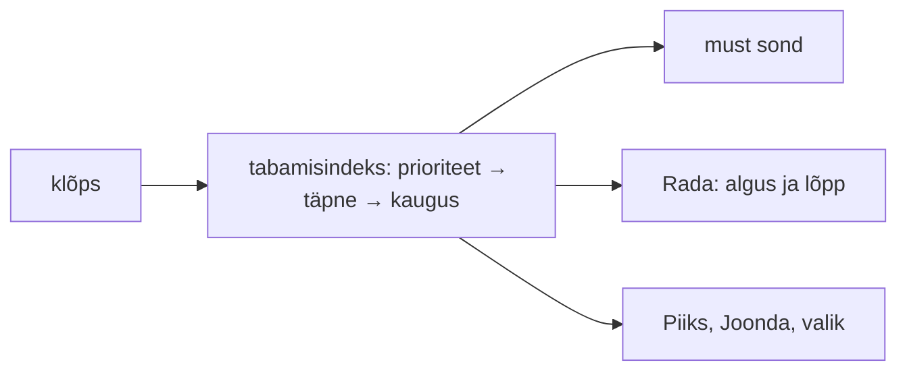

# M2-3-4 · Täpne jalavalik ja kahe vaate parandused

**Olek:** vastu võetud `8bc79b1` · **Rada:** B · **Haru:** `codex/m2-3` (tööpuu `C:/Users/TRUMPIT/.codex/worktrees/bb-m2-3/BB`) · **Alus:** `8155d6e` · **Plaan:** [M2.3 › Ülesanne 4](../plans/M2-3-skeemi-sumbolid-ja-paigutus.md) ja [arhitektuuriauditi triaaž](../review/2026-11-27-arhitektuuri-audit-cbd4d42.md#arhitekti-triaaž-2026-11-27), leiud 01, 02 ja 17

## Eesmärk
Kui tehnik klõpsab padja sees, salvestavad must sond ja Rada selle padja jala, mitte väiksema naaberjala (leid 01, P1). Reegel asub ühes kohas, tabamisindeksis, nii et iga tööriist saab sama valiku. Skeemi kaamera on salvestuse piiril kopeeritud samamoodi nagu plaadi kaamera (02). Vaatevahetuse järel näitavad jalus ja hiir sama tööriista (17). Skeemil on tähis sümbolist eraldi ja pikkade jalanimedega kast läheb laiemaks (M2-3-3 märkused 1 ja 2).

## Loe (ainult need)
- `packages/ui/src/canvas/hit-index.ts:215-257` (`query` ja `queryAll`; `HitMatch.exact` ja `pickHit` on read 27-42)
- `packages/features/connections/ui/TraceTool.ts:266-280` (raja algus võtab `queryAll`-i esimese vaste; lõpp `findTarget` read 113-150)
- `packages/engine/src/save-coordinator.ts:20-29` (`copyView`; avalik `currentView` real 199)
- `packages/ui/src/canvas/Canvas.tsx:165-172` (lõuendi tööriistad ja varuvariant `select`)
- `packages/domain/src/schematic/index.ts:90-160` (`makeSymbol` ja `box`)

## Muuda
- `packages/ui/src/canvas/hit-index.ts`: otsus 1.
- `packages/engine/src/save-coordinator.ts`: otsus 2.
- `packages/ui/src/canvas/Canvas.tsx`: otsus 3.
- `packages/domain/src/schematic/index.ts`, `types.ts` ja `packages/ui/src/canvas/label-obstacles.ts`: otsus 4.
- Testid jaotisest „Tõend“; `pnpm api`.

## Ära puutu
- Tööriistade failid (`PickRefTool`, `TraceTool`, `BeepTool`, `AlignTool`, `OwnPinTool`): nad saavad parandatud valiku indeksist. `pickHit` jääb samaks.
- Kihtide tabamuste kujud ja prioriteedid, Raja kihireegel, raja ja liitepunkti prioriteedid, käsud ja dokumendi vorming.
- Polaarse kondensaatori `+` märk (M2-3-3 märkus 3) jääb samaks.

## Otsused ja liidesed
1. **Täpne tabamus enne tabamisvaru** (leid 01).
   - `query` valib parima järjekorras: suurem `priority`, siis täpne tabamus (`exact`), siis väiksem kaugus. `queryAll` järjestab vasted samamoodi. `exact` arvutatakse nagu praegu `queryAll`-is: punkt `distance ≤ r`, ala sees, ristkülik ilma `rectMinHalf`-ita, ekraanilaiusega lõik kogu oma laiuses. Arvuta see ühes abifunktsioonis, mida mõlemad kasutavad.
   - Sama prioriteedi korral võidab tegeliku kuju tabamus tabamisvaru oma, isegi kui varu keskpunkt on lähemal. Kui kumbki pole täpne või mõlemad on täpsed, võidab väiksem kaugus nagu praegu. Suurema prioriteediga varu võidab endiselt väiksema prioriteediga täpse tabamuse.
   - Must sond (`hit` lõuendi `query`-st), raja algus (`matches[0]`) ja raja lõpp (`findTarget`) saavad parandatud valiku tööriista koodi muutmata.
2. **Mõlemad kaamerad kopeeritakse** (leid 02). `copyView` kopeerib `schematicView` välja `zoom` ja `pan` samamoodi nagu `boardView`. Ühine abifunktsioon ühe kaamera jaoks, mitte kaks koopiat koodist.
3. **Lõuend loobub tööriistast, mida tal pole** (leid 17). Kui seansi `toolId` pole `select`, `pan` ega lõuendi tööriistade hulgas, seab `Canvas` `useLayoutEffect`-is seansi tööriistaks `select`. Siis näitavad jalus ja hiir sama tööriista ning plaadile naastes on tööriist `select`. Pooleli raja mustand tühistub nagu praegu lõuendi vahetusel.
4. **Tähis ja kasti laius** (M2-3-3 märkused 1 ja 2).
   - `makeSymbol` paneb tähise ankru `bounds.min.y − 2,54`-le (enne `− 1,27`).
   - `MONO_ADVANCE_EM = 0.72` liigub `@pcbk/domain/schematic`-isse. `label-obstacles.ts` impordib selle sealt ja ekspordib edasi sama nimega, nii et tarbijad ei muutu.
   - Kasti poollaius `w` = max(5,08; ⌈`vaja` / 2 / 2,54⌉ × 2,54), kus `vaja` = (L + P) × `MONO_ADVANCE_EM` × 1,8 + 2 × 0,55 + 1,27. L ja P on vasaku ja parema külje pikima jalanime märkide arv (`Array.from(name).length`; nimeta küljel 0). Kasti servad on ±`w`, `inner.x` on ±`w` ja `end.x` on ±(`w` + 2,54), nii et iga `end` jääb ruudustikule. VCC/GND-kast ja nimedeta kastid jäävad praegusesse mõõtu (`w` = 5,08).

## Tõend
- Olemasolev test `nearest_pin_wins_inside_hit_radius` (`packages/ui/src/canvas/hit-index.test.ts`) kinnitab vana vigast käitumist: klõps on suure jala sees, kuid valitakse väikese naaberjala varu. Kustuta see; selle juhtumi katab test 1 uue ootusega. Kui mõni muu olemasolev test eeldab, et varu võidab sama prioriteediga täpse tabamuse, peatu ja küsi.
- TS:
  - `exact_hit_beats_margin_at_equal_priority` (`packages/ui/src/canvas/hit-index.test.ts`): U1.1 punkt raadiusega 10 kohas (120; 100), U1.2 punkt raadiusega 2,5 kohas (135; 100), klõps (129,5; 100), suum 1. `query`, `queryAll`-i esimene vaste ja `pickHit` annavad U1.1. Kui klõps on mõlema varus, kuid kummagi kuju sees mitte, võidab lähem. Kui klõps on mõlema kuju sees, võidab lähem. Suurema prioriteediga varu võidab väiksema prioriteediga täpse tabamuse.
  - `black_probe_and_trace_take_the_pad_under_the_cursor` (`packages/features/pin-pick.test.tsx`, uus; abikood nagu `measurements/ui/measurements-ui.test.tsx` ja `connections/ui/trace-tool.test.tsx`): sünteetilisel plaadil on suur ümar padi U1.1 ja väike ümar naaberpadi U1.2. Klõps on U1.1 sees, aga U1.2 6 px varus. Must sond saab U1.1. Selle punkti juurest U1.4-ni joonistatud rada salvestab U1.1↔U1.4. U1.4-st alustatud ja samas punktis lõpetatud rada salvestab U1.4↔U1.1.
  - `returned_views_cannot_alter_saved_cameras` (`packages/engine/src/project-view.test.ts`): parameetriline test `boardView` ja `schematicView` jaoks. Avamise vastuse ja `currentView()` tulemuse `pan.x` muutmine ei muuda järgmist avamist ega salvestatud faili. Kirjutuste arv ei kasva.
  - `view_switch_drops_tool_the_view_lacks` (`packages/ui/src/shell/view-switch.test.tsx`): plaadil on aktiivne testitööriist, mida skeemi lõuendil pole. `Ctrl+Tab` järel on seansi tööriist `select` ja skeemil klõps valib. Tagasi plaadil on tööriist endiselt `select`.
  - `symbol_label_clears_body_and_box_fits_names` (`packages/domain/src/schematic/symbols.test.ts`): kõigi 16 sümboli tähise ankur on vähemalt 2,54 mm `bounds.min.y`-st kõrgemal. Kast nimedega `RESET` (vasakul) ja `VCC_IO` (paremal) on poollaiusega 10,16 ja `end.x` on ±12,7. Vasaku nime lõpp jääb parema nime algusest vähemalt 1,27 mm vasakule. VCC/GND-kast on endiselt poollaiusega 5,08. Iga `end` on ruudustikul.
- Ekraanipilt: M2-3-3 E2E kordus annab `output/playwright/m2-3-3/symbols-light.png`. Kopeeri see üleandmiseks `output/playwright/m2-3-4/symbols-light.png`-ks; tähised ei puuduta sümboleid.
- Rada B täisring: põhikaustast `pnpm bb-review-card M2-3-4` (koos `cargo test`-iga) → `ok: true`, `missing: []`.

## Valmis kui
- [x] Testid läbivad. `nearest_pin_wins_inside_hit_radius` on eemaldatud ja kalibreerimistesti seadistus on kohandatud arhitekti kinnitatud ulatuses.
- [x] Ekraanipilt on üleandmises.
- [x] `docs/api` on uuendatud.
- [x] Üleandmine on allpool, kuni 25 rida, koos otsuste kaardi ja failidega väljaspool „Muuda“-loendit; commit'i sõnumi mustand on `output/commit-msg/M2-3-4.txt` ([kaartide reeglid 9–10](README.md#reeglid)).

## Arhitekti vastus ehitajale (2026-11-27)

**Küsimus:** `CalibrationLayer.test.tsx` 13 katset kukkusid, sest ühine seadistus aktiveerib kalibreerimistööriista, aga annab lõuendile `tools={[]}`. Otsus 3 lülitab sellise tööriista välja. Kas tohib ühisesse mount-i lisada `tools={[calibrateToolSpec()]}` ja impordi?

**Vastus: jah.** Päris rakenduses registreerib `photo/ui/index.tsx:28` kalibreerimistööriista plaadi lõuendile. Test lihtsalt ei kordanud seda. Kontrollisin, et iga tööriist, millele rakendus `setToolId`-iga lülitub (Piiks, must sond, Rada, Paiguta, Joonda, oma jalg, kalibreerimine), on oma mooduli `tools` loendis. Seega muudab otsus 3 ainult teste, mis seda registreerimist ei teinud.
- Lisa sellesse faili ainult ühisesse mount-i tööriista registreerimine ja vajalik import. Punktid, katseandmed ja ootused jäävad samaks.
- Kui täisringis kukub mõni teine test samal põhjusel (tööriist on aktiivne, aga testi lõuendil registreerimata, kuigi päris rakendus selle registreerib), on sama üherealine registreerimine lubatud. Loetle need failid üleandmises.
- Kui test kukub muul põhjusel või kui tööriista pole päris rakenduses lõuendi loendis, peatu ja küsi.

## Üleandmine

- Tööpuu `C:/Users/TRUMPIT/.codex/worktrees/bb-m2-3/BB`, haru `codex/m2-3`, alus `8155d6e`. Algseis oli puhas.
- Viis kaarditesti andsid alusel RED-i. Kaameratesti plaadivaate juhtum läbis juba alusel ja skeemivaate juhtum kukkus läbi.
- Tööpuu `output/playwright/m2-3-4/` RED-logid `hit-index-red.log`, `pin-pick-red.log`, `view-cameras-red.log`, `view-tool-red.log` ja `symbol-label-red.log`.
- Otsus 1 → `packages/ui/src/canvas/hit-index.ts:182` (tabamuse liik), `packages/ui/src/canvas/hit-index.ts:201` (ühine järjestus).
- Otsus 2 → `packages/engine/src/save-coordinator.ts:27` (kaamera koopia) ja `packages/engine/src/save-coordinator.ts:31` (mõlemad vaated).
- Otsus 3 → `packages/ui/src/canvas/Canvas.tsx:217` (puuduva tööriista asendamine).
- Otsus 4 → `packages/domain/src/schematic/index.ts:90` (tähis) ja `packages/domain/src/schematic/index.ts:119` (laius), `packages/domain/src/schematic/types.ts:6` ja `packages/ui/src/canvas/label-obstacles.ts:15` (ühine font).
- `git diff --stat`-i ja uute failide võrdlus „Muuda“- ning „Ära puutu“-loendiga hõlmas 13 tööpuufaili.
- Ainus „Muuda“-loendi väline fail `packages/features/photo/ui/CalibrationLayer.test.tsx:24` sai arhitekti kinnitatud kohanduse. Ühine `mount` registreerib `calibrateToolSpec()`-i ja lisatud on vajalik import, sest lõuend lülitab registreerimata tööriista välja. Katseandmed ja ootused säilisid.
- Eemaldasin kaardil nimetatud `nearest_pin_wins_inside_hit_radius`. Kalibreerimistesti seadistus oli ainus olemasoleva testi kohandus.
- M2-3-3 sünteetiline E2E kordus läbis. Tööpuu `output/playwright/m2-3-4/symbols-light.png` näitab 22 sümbolit 179% suumiga ning tähiseid sümbolitest eraldi.
- `pnpm api` uuendas `docs/api/domain-schematic.md`. `pnpm api:check` läbis ja sõltuvuskontroll leidis 0 rikkumist.
- Põhikausta `pnpm bb-review-card M2-3-4` andis `ok: true`, `missing: []`. Läbis 1770 Vitesti, 48 E2E ja 108 Rusti testi. Kaks Rusti testi jäid vahele.
- Raport `output/review-card/M2-3-4-W7uT4z/summary.json` ja commit’i sõnumi mustand `output/commit-msg/M2-3-4.txt` on põhikaustas.

## Arhitekti ülevaatus (2026-11-27)

- Tööpuus on 13 muudetud või uut faili, nagu üleandmises. Kokkuvõte `M2-3-4-W7uT4z/summary.json` (23:16) on uuem kui viimane muudatus (23:09), seega ei käivitanud kontrolle uuesti: rada B, `ok: true`, `missing: []`, Vitest 1770/1770, E2E 48/48, Rust 108/110 (kaks `ignore`-märgisega). Kõigi seitsme kontrolli väljumiskood on 0.
- Otsus 1 (`hit-index.ts:182-207`, `:243-263`): `matchHit` arvutab vaste ja `exact`-i ühes kohas ning `compareHits` järjestab: prioriteet, täpne tabamus, kaugus. `query` ja `queryAll` kasutavad sama võrdlust ja `pickHit` jäi samaks. Tööriistade faile ei muudetud.
- Otsus 2 (`save-coordinator.ts:27-40`): `copyCamera` kopeerib mõlemad kaamerad ja `currentView` kasutab sama `copyView`-d.
- Otsus 3 (`Canvas.tsx:217-223`): kui aktiivne on varuvariant `select`, aga seansi `toolId` on midagi muud, seab lõuend selle `select`-iks. `pan` jääb puutumata, sest sellel on oma tööriist.
- Otsus 4 (`schematic/index.ts:96`, `:119-170`): tähis on 2,54 mm kõrgemal ja kasti poollaius tuleb kaardi valemist. `MONO_ADVANCE_EM` on ainult domeenis ja `label-obstacles.ts` ekspordib selle edasi. Sõltuvuskontroll lubab seda importi juba M2-3-3-st.
- Testid: `nearest_pin_wins_inside_hit_radius` on kustutatud ja selle juhtum on uues testis vastupidise ootusega. `pin-pick.test.tsx` kasutab päris tööriistu ja klõpse, mitte ainult indeksit. `CalibrationLayer.test.tsx`-is muutus ainult lubatud tööriista registreerimine.
- Ekraanipildi vaatasin ise üle: 22 sümbolit on 179% suumiga ja ükski tähis ei puuduta sümbolit. Lühikeste nimedega kastid on endises mõõdus. Laiemat kasti ekraanipildil pole; seda katab domeenitest.

**Otsus: sobib.**

Mitteblokeeriv märkus: commit'i sõnumi pealkirjas puudub ulatus. Lisan selle commit'imisel (`fix(canvas): …`).
