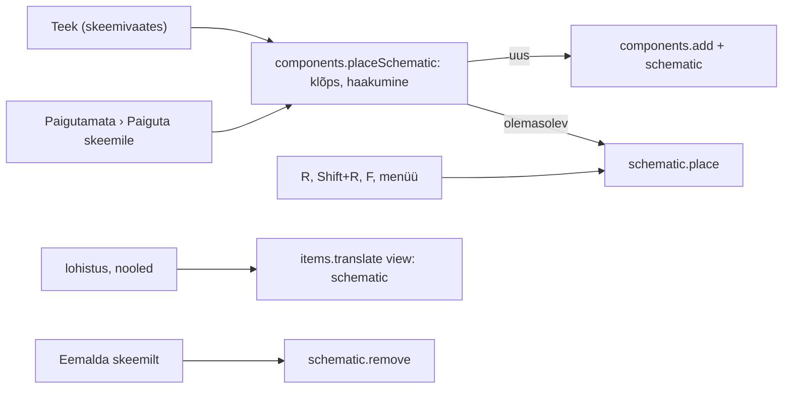

# M2-3-5 · Komponendid skeemil

**Olek:** vastu võetud `a0393d9` · **Rada:** B · **Haru:** `codex/m2-3` (tööpuu `C:/Users/TRUMPIT/.codex/worktrees/bb-m2-3/BB`) · **Alus:** `8bc79b1` · **Plaan:** [M2.3 › Ülesanne 5](../plans/M2-3-skeemi-sumbolid-ja-paigutus.md) (otsused 4 ja 5, O5)

## Eesmärk
Skeemivaates saab komponendi teegist lisada või loendist „Paigutamata“ skeemile paigutada. Paigutatud sümbolit saab lohistada, nooleklahviga nihutada, pöörata (`R`, `Shift+R`), peegeldada (`F`) ja skeemilt eemaldada. Iga tegevus on üks `Ctrl+Z` samm ja `at` on alati 2,54 mm ruudustikul. Skeemil lisatud komponent ilmub plaadi loendisse „Paigutamata“ ja selle saab plaadile paigutada nagu praegu. Kustutamine eemaldab komponendi mõlemast vaatest.

## Loe (ainult need)
- `packages/features/components/engine/commands.ts:119-138` (`components.add`; `components.rotate` read 285-296)
- `packages/domain/src/rules/items.ts:57-68` (`translateItems`; käsk `packages/engine/src/items.ts:23-35`)
- `packages/ui/src/canvas/SelectTool.ts:96-178` (lohistuse eelvaade, `items.translate`, nooleklahvid)
- `packages/ui/src/shell/UiRegistry.ts:56-80` (`SelectionKindSpec` ja `UiModule` pesad; koondajad read 205-280)
- `packages/features/components/ui/PlaceTool.ts:53-140` (paigutustööriista režiimid; algus `place-store.ts:38-46`)

## Muuda
- `packages/domain/src/schematic/` (abifunktsioonid) ja `packages/domain/src/rules/items.ts`: otsus 1.
- `packages/contracts/src/document-engine.ts`, `packages/engine/src/items.ts`, `packages/features/components/contract.ts`, `engine/commands.ts` ja `engine/derive.ts`: otsus 2.
- `packages/features/schematic/contract.ts` (uus) ja `engine/`: otsus 3.
- `packages/ui/src/shell/UiRegistry.ts`, `packages/ui/src/canvas/Canvas.tsx`, `SelectTool.ts` ja `packages/ui/src/app/SchematicCanvas.tsx`: otsus 4.
- `packages/features/schematic/ui/` (klahvid, menüü, eelvaade, `i18n/et.ts`): otsus 5.
- `packages/features/components/ui/` (valikuliik, skeemi paigutustööriist, loendid, `i18n/et.ts`): otsus 6.
- Testid jaotisest „Tõend“; `pnpm api`.

## Ära puutu
- Plaadi käitumine, plaadi klahvid ja menüü, dokumendi vorming (`SymbolPlacement` on juba olemas).
- `schematic.setSymbol`, jalgade funktsioon ja „Näita teises vaates“ (ülesanne 6), tähise lohistamine (`labelOffset`) ja juhtmed (M2.4).
- Skeemi paigutuse kummitus kursori all: seda selles kaardis ei tehta.

## Otsused ja liidesed
1. **Domeen.**
   - `@pcbk/domain/schematic` ekspordib `snapToSchematicGrid(point: Vec2): Vec2` (mõlemad koordinaadid lähima 2,54 kordseni) ja `schematicSymbolId(kind: ComponentKind): SymbolId | null` (sama tabel, mida `schematicSymbol` kasutab; `via` ja `hole` annavad `null`).
   - `translateItems(doc, items, delta, view: 'board' | 'schematic' = 'board')`. Vaatega `schematic` saab `schematic.at` väärtuse `snapToSchematicGrid(at + delta)` ja plaadipaigutus ei muutu. Skeemita komponent annab `RuleRejected('component_not_on_schematic')`.
2. **Olemasolevad käsud.**
   - `items.translate` saab valikulise välja `view?: 'board' | 'schematic'` (vaikimisi `board`).
   - `components.add` saab valikulise välja `schematic?: { at: Vec2; rot: 0 | 90 | 180 | 270; mirror: boolean }`. Salvestub `{ symbol: schematicSymbolId(kind), at: snapToSchematicGrid(at), rot, mirror }`. Kui `schematicSymbolId` annab `null`, lükatakse käsk tagasi koodiga `no_symbol`. `board` ja `schematic` võivad olla koos, eraldi või puududa.
   - Tuletis `unplacedSchematic` jätab `via` ja `hole` välja (O5).
3. **Moodul `schematic`** (`contract.ts` täiendab `CommandMap`-i; käsud kirjutavad välja `components`, `alsoWrites: ['components']`).
   - `schematic.place` `{ items: { id; at; rot; mirror }[] }` paigutab või muudab paigutust ühe sammuna. Olemasolevad `pinMap` ja `labelOffset` säilivad, `symbol` tuleb `schematicSymbolId`-st ja `at` haakub ruudustikule. `via` ja `hole` lükatakse tagasi koodiga `no_symbol`, puuduv id nagu teistes komponendikäskudes.
   - `schematic.remove` `{ ids: string[] }` kustutab `schematic` välja. Komponent, jalad, ühendused, mõõtmised ja plaadipaigutus jäävad alles.
4. **Lõuend ja register.**
   - `UiModule` saab pesad `schematicTools`, `schematicKeys` ja `schematicContextMenu`. `SelectionKindSpec` saab `schematicMoveRef?` ja `schematicInFrame?`. Registri koondajad on samad mis plaadil (`schematicTools()`, `schematicKeys()`, `schematicContextMenu(kind)`, `schematicMoveRefs`, `schematicItemsInFrame`). `deleteIds` on mõlemal vaatel ühine.
   - `Canvas` saab propsi `space?: 'board' | 'schematic'` (vaikimisi `board`). Vaates `schematic` lisab valikutööriist `items.translate`-ile `view: 'schematic'`. Nooleklahvi samm on seal 2,54 mm (`Shift` korral 25,4).
   - `SchematicCanvas` annab `Canvas`-ile `space="schematic"`, skeemi tööriistad, klahvid, menüü, `schematicMoveRefs`, `schematicItemsInFrame` ja `deleteIds`.
5. **Skeemi UI (moodul `schematic`).**
   - Sümbolikiht arvestab valikutööriista nihke eelvaadet: lohistatav sümbol on punktis `snapToSchematicGrid(at + nihe)`, nii et eelvaade ja tulemus kattuvad.
   - `schematicKeys`: `R` pöörab valitud skeemikomponente +90° (`rot` = (`rot` + 90) mod 360), `Shift+R` −90° ja `F` vahetab `mirror`-i. Iga klahv on üks `schematic.place` kõigi valitud komponentidega.
   - `schematicContextMenu` (`appliesTo: ['component']`): „Pööra +90°“ (`R`), „Pööra −90°“ (`Shift+R`), „Peegelda“ (`F`) ja „Eemalda skeemilt“.
6. **Lisamine ja loendid (moodul `components`).**
   - Komponendi valikuliik saab `schematicMoveRef`-i (komponendil on `schematic`) ja `schematicInFrame`-i (sümboli `bounds`-i neli teisendatud nurka on raami sees).
   - `schematicTools`: tööriist `components.placeSchematic` (ristkursor). Klõps skeemil haagib punkti ruudustikule. Režiimis `new` (teegist) tuleb `components.add` sama kirje tüübi ja jalgadega, kuid ilma `board`-ita, `schematic` on `{ at, rot: 0, mirror: false }`. Tööriist jääb aktiivseks järgmise templi jaoks nagu plaadil. Uus režiim `schematic` `{ componentId }` loendist teeb `schematic.place`-i ja lõpetab. `Esc` lõpetab mõlemad.
   - `beginPlacement` valib tööriista aktiivse vaate järgi: skeemivaates `components.placeSchematic`, plaadivaates nagu praegu.
   - Komponentide paneel skeemivaates: filtrid „Skeemil (n)“ ja „Paigutamata (n)“. Arvud tulevad `schematic`-ist ja `unplacedSchematic`-ist. Loendi „Paigutamata“ kirje nupp on „Paiguta skeemile“, mis alustab režiimi `schematic`. Plaadivaates jääb paneel samaks.
   - Plaani ülesandes oli lohistamine loendist skeemile. Kaardil on selle asemel „Paiguta skeemile“ ja klõps skeemil, sest plaadil töötab paigutamine samamoodi, KiCadis ka, ja lohistamise jaoks rakenduses taristut pole.

## Tõend
- TS:
  - `schematic_commands_place_rotate_mirror_remove_in_one_step` (`packages/features/schematic/engine/commands.test.ts`): `schematic.place` haagib `at` (12,3; 7,1) punkti (12,7; 7,62). Teine `place` uue `rot`-i ja `mirror`-iga säilitab `pinMap`-i ja `labelOffset`-i. Kahe komponendi `place` on üks `Ctrl+Z` samm. `schematic.remove` jätab komponendi, plaadipaigutuse ja ühendused alles. `via`, `hole` ja puuduv id lükatakse tagasi ilma dokumenti muutmata.
  - `add_and_translate_on_schematic_snap_to_grid` (`packages/features/components/engine/schematic-placement.test.ts`): `components.add` ainult `schematic`-iga annab komponendi ilma `board`-ita, `symbol` tuleb tüübist ja id on `unplacedBoard`-is. `via` koos `schematic`-iga lükatakse tagasi (`no_symbol`). `items.translate` vaatega `schematic` haagib `at`-i ja jätab `board.center`-i samaks. Ilma vaateta muutub ainult plaat nagu enne. Skeemita komponent lükatakse tagasi. `unplacedSchematic` ei sisalda `via`-t ega `hole`-i.
  - `schematic_canvas_moves_frames_and_deletes` (`packages/ui/src/app/schematic-canvas.test.tsx`): lohistusel näitab sümbolikiht haagitud asukohta. Lahtilaskmine teeb ühe `items.translate`-i vaatega `schematic`. Nool liigutab 2,54 mm ja `Shift`-nool 25,4 mm. Raamvalik valib sümbolid, mille nurgad on raamis. `Delete` eemaldab komponendi mõlemast vaatest.
  - `schematic_keys_and_menu_rotate_mirror_remove` (`packages/features/schematic/ui/schematic-keys.test.tsx`): kahe valitud sümboliga on `R`, `Shift+R` ja `F` igaüks üks samm. Kontekstimenüüs on neli kirjet koos kiirklahvidega ja „Eemalda skeemilt“ jätab komponendi alles. Plaadi `R` pöörab endiselt plaadipaigutust ega puuduta skeemi.
  - `schematic_place_from_library_and_unplaced_list` (`packages/features/components/ui/schematic-place.test.tsx`): skeemivaates annab teegi kirje ja klõps uue komponendi, millel on ainult `schematic`. See on plaadi loendis „Paigutamata“ ja seal toimib „Paiguta plaadile“. Paneel näitab skeemivaates „Skeemil“ ja „Paigutamata“, `via` ja `hole` puuduvad. „Paiguta skeemile“ ja klõps teevad `schematic.place`-i ja tööriist lõpetab.
- E2e:
  - `schematic_place_move_rotate_undo` (`apps/web/e2e/m2-3-place.spec.ts`, uus): sünteetiline projekt, mille komponendid pole skeemil. Skeemivaates paigutatakse R1, Q1 ja U1 loendist, R1 lohistatakse, Q1-le tehakse `R` ja `F`, U1-le „Eemalda skeemilt“. Iga `Ctrl+Z` taastab eelmise seisu ja `at` on alati ruudustikul. Ekraanipilt `output/playwright/m2-3-5/placed-light.png` on tehtud enne eemaldamist ja vähemalt 150% suumiga: pööratud ja peegeldatud Q1 tähis on püsti.
- Rada B täisring: põhikaustast `pnpm bb-review-card M2-3-5` (koos `cargo test`-iga) → `ok: true`, `missing: []`.

## Valmis kui
- [x] Testid läbivad, olemasolevad ootused on samad.
- [x] Ekraanipilt on üleandmises.
- [x] `docs/api` on uuendatud.
- [x] Üleandmine on allpool, kuni 25 rida, koos otsuste kaardi ja failidega väljaspool „Muuda“-loendit; commit'i sõnumi mustand on `output/commit-msg/M2-3-5.txt` ([kaartide reeglid 9–10](README.md#reeglid)).

## Üleandmine

- Tööpuu `C:/Users/TRUMPIT/.codex/worktrees/bb-m2-3/BB`, haru `codex/m2-3`, alus `8bc79b1`. Algseis oli puhas.
- Kuus kaarditesti andsid alusel RED-i. Tööpuu `output/playwright/m2-3-5/` logid `schematic-commands-red.log`, `schematic-canvas-red.log`, `schematic-keys-red.log`, `schematic-place-red.log` ja `schematic-place-e2e-red.log`.
- Otsus 1 → `packages/domain/src/schematic/index.ts:173` ja `packages/domain/src/rules/items.ts:58`.
- Otsus 2 → `packages/contracts/src/document-engine.ts:12`, `packages/engine/src/items.ts:23`, `packages/features/components/engine/commands.ts:120` ja `packages/features/components/engine/derive.ts:16`.
- Otsus 3 → `packages/features/schematic/contract.ts:4` ja `packages/features/schematic/engine/index.ts:14`.
- Otsus 4 → `packages/ui/src/shell/UiRegistry.ts:63`, `packages/ui/src/canvas/Canvas.tsx:33`, `packages/ui/src/canvas/SelectTool.ts:94` ja `packages/ui/src/app/SchematicCanvas.tsx:50`.
- Otsus 5 → `packages/features/schematic/ui/symbol-layer.tsx:169`, `packages/features/schematic/ui/schematic-actions.ts:65` ja `packages/features/schematic/ui/i18n/et.ts:1`.
- Otsus 6 → `packages/features/components/ui/index.tsx:123`, `packages/features/components/ui/PlaceTool.ts:152`, `packages/features/components/ui/place-store.ts:40`, `packages/features/components/ui/ComponentsPanel.tsx:13` ja `packages/features/components/ui/UnplacedList.tsx:55`.
- Võrdlesin `git diff --stat`-i ja uusi faile kaardi „Muuda“- ja „Ära puutu“-loendiga. Tööpuus on 41 muudetud või lisatud faili.
- Väljaspool „Muuda“-loendit `packages/features/__tests__/helpers.ts:44` lisab kaarditestidele täiskooste seadistuse. Senine testiseadistus säilib.
- Väljaspool „Muuda“-loendit `apps/desktop/src/perf/probe-fixes.test.ts:154` sai ainsa olemasoleva testi mehaanilise kohanduse. Plaadi fikstuuri tüüp välistab uue valikulise `schematic`-käsusisendi. Katseandmed ja ootused säilisid.
- Kõik 34 muudetud lähte- ja testifaili on kuni 400 rida. `pnpm api` ja `pnpm api:check` läbisid. Automaatsed API kokkuvõtted `ui-shell-state.md` (407) ja `features-components-contract.md` (417) annavad pikkusehoiatuse.
- E2E kinnitas seitse muudatust ja seitse tagasivõttu salvestatud sünteetilises projektis. Uue E2E 60 s ajapiir katab 14 salvestusootust.
- Tööpuu `output/playwright/m2-3-5/placed-light.png` on tehtud enne U1 eemaldamist 179% suumiga. Pööratud ja peegeldatud Q1 tähis on püsti.
- Põhikausta `pnpm bb-review-card M2-3-5` andis `ok: true`, `missing: []`. Läbis 1775 Vitesti, 49 E2E ja 108 Rusti testi. Kaks Rusti testi jäid vahele.
- Raport `output/review-card/M2-3-5-RZteQt/summary.json` ja commit’i sõnumi mustand `output/commit-msg/M2-3-5.txt` on põhikaustas.

## Arhitekti ülevaatus (2026-11-28)

- Tööpuus on 41 muudetud või uut faili, nagu üleandmises. Kokkuvõte `M2-3-5-RZteQt/summary.json` (00:26) on uuem kui viimane muudatus (2026-11-27 23:37), seega ei käivitanud kontrolle uuesti: rada B, `ok: true`, `missing: []`, Vitest 1775/1775, E2E 49/49, Rust 108/110 (kaks `ignore`-märgisega). Kõigi seitsme kontrolli väljumiskood on 0.
- Otsus 1: `snapToSchematicGrid` ja `schematicSymbolId` on domeenis. `translateItems` liigutab vaatega `schematic` ainult `at`-i ja haagib selle ruudustikule; skeemita komponent lükatakse tagasi.
- Otsus 2: `items.translate` ja `components.add` said valikulise välja. `components.add` lükkab `via` ja `hole` skeemiga tagasi ning salvestab `symbol`-i tüübist. `unplacedSchematic` jätab `via` ja `hole` välja.
- Otsus 3 (`schematic/engine/index.ts`): `schematic.place` säilitab olemasolevad väljad (`...target.schematic`) ja tagasilükkamine katkestab kogu käsu. `schematic.remove` kustutab ainult `schematic` välja. Mõlemal on `alsoWrites: ['components']`.
- Otsus 4: register koondab pesad ühiste abifunktsioonidega (`validateBindings`, `menuItems`, `collectMoveRefs`, `collectItemsInFrame`); plaadi ja skeemi kiirklahvid kontrollitakse eraldi. Valikutööriist lisab `view: 'schematic'` ainult skeemil ja nihutab seal 2,54 mm sammuga.
- Otsus 5: sümbolikiht nihutab eelvaates kogu sümboli haagitud asukohta. Klahvid ja menüü kasutavad sama `schematic.place`-i kõigi valitud komponentidega.
- Otsus 6: skeemi paigutustööriist teeb teegist `components.add` ilma `board`-ita ja loendist `schematic.place`-i; plaadi tööriist ignoreerib skeemirežiimi. Teek peidab skeemivaates `via` ja `hole` kirjed. See on loogiline lisa, mida kaart ei nõudnud.
- Väljaspool „Muuda“-loendit: testiabi `setupWithAllFeatures` (`features/__tests__/helpers.ts`) ja üks mehaaniline tüübimärgend failis `probe-fixes.test.ts`; andmed ja ootused on samad.
- Vaatasin ekraanipildi ise üle, Q1 ka suurendatult: R1, Q1 ja U1 on 179% suumiga ruudustikul. Pööratud ja peegeldatud Q1-l on baasikriips, emitteri nool osutab baasist eemale ja tähis on püsti. Paneel näitab „Skeemil (3)“ ja Q1 omadustes on „Plaadile paigutamata“.

**Otsus: sobib.**

Mitteblokeerivad märkused:
1. Skeemivaate filter „Skeemil“ ei näita tühjana teksti (`PlacedList` tagastab `null`). Lõuendi vihje „Skeemil pole veel komponente.“ katab selle seni.
2. `Canvas.tsx`-ist kadus kaks tühja rida, mis ei ole seotud ühegi otsusega.
3. API kokkuvõtted `ui-shell-state.md` (407 rida) ja `features-components-contract.md` (417 rida) ületavad 400 rea hoiatuse. Need on genereeritud failid; jagamine on Astra `api-digest` töö (arhitektuuriauditi leid 20 juures).
