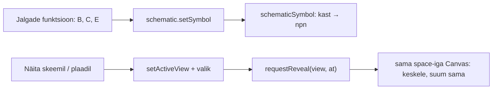

# M2-3-6 · Jalgade funktsioon, ühine valik ja „Näita teises vaates“

**Olek:** ehitamiseks · **Rada:** B · **Haru:** `codex/m2-3` (tööpuu `C:/Users/TRUMPIT/.codex/worktrees/bb-m2-3/BB`) · **Alus:** `a0393d9` · **Plaan:** [M2.3 › Ülesanne 6](../plans/M2-3-skeemi-sumbolid-ja-paigutus.md) (otsused 3, 4 ja 6; [02 § 13.1](../02-kasutaja-teekond.md#131-skeem-muudetav))

## Eesmärk
Kontekstipaneelis saab määrata, milline jalg on sümboli kontakt (näiteks transistor: 2 → B, 1 → C, 3 → E). Siis muutub nummerdatud kast õigeks sümboliks ja tegevuse saab tagasi võtta ühe `Ctrl+Z`-ga. „Näita skeemil“ ja „Näita plaadil“ vahetavad vaate, hoiavad valiku ja toovad komponendi vaate keskele suumi muutmata. Skeemil on tuvastamata komponendi tähise järel küsimärk ning DNP komponendi tähis on läbi kriipsutatud ja sümbol hall, nagu plaadil.

## Loe (ainult need)
- `packages/domain/src/schematic/index.ts:37-80` (kontaktide nimed ja `pinMap`-i kehtivuse reegel)
- `packages/ui/src/canvas/use-canvas-controls.ts:38-91` („Sobita“ ja suumi soovi mustriga tuleb keskendamise soov)
- `packages/features/schematic/ui/schematic-actions.ts:1-90` (skeemi menüü ja `schematic.place`-i kasutus)
- `packages/features/components/ui/layers/ComponentShape.tsx:136-176` (plaadi tähistus: küsimärk, läbikriipsutus ja 0,4 läbipaistvus)
- `packages/ui/src/shell/UiRegistry.ts:38-43` (`ContextSectionSpec`)

## Muuda
- `packages/domain/src/schematic/`: otsus 1.
- `packages/features/schematic/contract.ts` ja `engine/`: otsus 2.
- `packages/features/schematic/ui/` (paneeli jaotis, menüükirjed, sümbolikiht, `i18n/et.ts`): otsused 3–5.
- `packages/ui/src/shell/view-store.ts`, `packages/ui/src/canvas/use-canvas-controls.ts` ja vajadusel `Canvas.tsx`: otsus 4.
- Testid jaotisest „Tõend“; `pnpm api`.

## Ära puutu
- Moodulid `components`, `connections`, `measurements`; dokumendi vorming (`pinMap` on `SymbolPlacement`-is juba olemas).
- Tavaline valik ei liiguta vaadet. Kummagi vaate suum ja asukoht säilivad nagu praegu.
- Kahe sümmeetrilise jalaga osad, klemm ja kastid ei saa jalgade funktsiooni jaotist.

## Otsused ja liidesed
1. **Domeen.** `@pcbk/domain/schematic` ekspordib `schematicContacts(kind: ComponentKind): readonly string[]`. See annab nimega kontaktid samast tabelist, mida `schematicSymbol` kasutab: polaarne kondensaator `+`, `-`; diood, LED ja Zener `A`, `K`; npn ja pnp `B`, `C`, `E`; nmos ja pmos `G`, `D`, `S`. Muud tüübid annavad tühja loendi.
2. **Käsk `schematic.setSymbol`** `{ id: string; pinMap: Record<string, string> | null }`, `alsoWrites: ['components']`.
   - Skeemita komponent lükatakse tagasi koodiga `component_not_on_schematic`.
   - `pinMap: null` kustutab `pinMap`-i ja sümbol tuleb jälle jalgade nimedest.
   - Muu `pinMap` kehtib ainult siis, kui `schematicContacts` pole tühi, võtmed on täpselt need kontaktid ja väärtused on erinevad olemasolevad jalad. Muidu tuleb tagasilükkamine koodiga `invalid_pin_map`.
   - `symbol`, `at`, `rot`, `mirror` ja `labelOffset` jäävad samaks. Iga käsk on üks samm ajaloos.
3. **Jaotis „Jalgade funktsioon“** (`contextSections`, `appliesTo: ['component']`). Jaotis on nähtav, kui komponendil on `schematic` ja `schematicContacts` pole tühi.
   - Kui jalgade arv erineb kontaktide arvust, on ainult tekst: „Sümbolil on {n} kontakti, komponendil {m} jalga. Skeemil on see kastina.“
   - Muidu on igal kontaktil valik (`aria-label` „Kontakt B“). Valikus on „—“ ja iga jalg kujul `1` või `1 · C` (id ja nimi). Algväärtus tuleb praegusest sümbolist (`schematicSymbol(component).pins`), kastil on kõik valikud „—“.
   - Kui sümbol on kast, on jaotises tekst: „Jalgade nimed ei anna funktsiooni üheselt. Skeemil on komponent kastina.“
   - „Salvesta“ on aktiivne, kui igal kontaktil on erinev jalg ja vastavus erineb praegusest. Nupp teeb `schematic.setSymbol`-i.
   - „Kasuta jalgade nimesid“ on nähtav, kui `pinMap` on olemas. Nupp teeb `schematic.setSymbol`-i väärtusega `pinMap: null`.
4. **Näita teises vaates.**
   - Vaatehoidla saab soovi `requestReveal(view: 'board' | 'schematic', at: Vec2)`. Soov jääb ootele, kuni sama `space`-iga lõuend on mõõdetud. Siis nihutab lõuend vaadet nii, et `at` on nähtava ala keskel: `fitInsets` arvestatakse nagu „Sobita“ puhul ja suum ei muutu. Plaadil läbib punkt stseeni teisenduse (`sceneTransform`), nii et ka pööratud fotoga plaadil tuleb komponent keskele. Pärast rakendamist soov kustub.
   - Moodul `schematic` lisab plaadi menüüsse (`contextMenu`) kirje „Näita skeemil“ (saadaval, kui komponendil on `schematic`) ja skeemi menüüsse (`schematicContextMenu`) kirje „Näita plaadil“ (saadaval, kui komponendil on `board`). Kirje valib komponendi, vahetab vaate ja küsib keskendamist punktiga `schematic.at` või `board.center`.
5. **Tähistus skeemil (02 § 13.1).** Kui `identified` on väär, on tähise järel ` ?` 0,75-kordse kirjasuurusega. Tähise tabamuse ristkülik arvestab ka seda osa. Kui `dnp` on tõene, on tähis läbi kriipsutatud ja sümboli rühmal on `opacity` 0,4.

## Tõend
- TS:
  - `set_symbol_maps_contacts_in_one_step` (`packages/features/schematic/engine/commands.test.ts`): nimedeta NPN skeemil on kast. `pinMap` `{ B: '2', C: '1', E: '3' }` teeb sellest npn-i, mille kontakt `B` on jalal 2. Üks `Ctrl+Z` toob kasti tagasi ja `pinMap: null` kustutab vastavuse. Puuduv kontakt, korduv jalg, tundmatu jalg, lisavõti, takisti ja skeemita komponent lükatakse tagasi ilma dokumenti muutmata. `at`, `rot`, `mirror` ja `labelOffset` jäävad samaks.
  - `pin_function_section_turns_box_into_symbol` (`packages/features/schematic/ui/pin-function.test.tsx`): nimedeta Q1 skeemil näitab kasti teksti ja kolme valikut B, C ja E. Valik ja „Salvesta“ muudavad sümbolikihis Q1 `data-symbol` väärtuseks `npn`. „Kasuta jalgade nimesid“ toob kasti tagasi. Neljajalgne NPN näitab ainult arvude teksti. Takistil ja skeemita komponendil jaotist pole.
  - `show_in_other_view_keeps_zoom_and_selection` (`packages/features/schematic/ui/show-other-view.test.tsx`): mõlemas vaates paigutatud R1 puhul viib plaadi menüü „Näita skeemil“ skeemivaatesse. R1 on endiselt valitud, skeemi suum on sama ja `at` on nähtava ala keskel ühe piksli täpsusega. „Näita plaadil“ toob plaadil `board.center`-i keskele ka 90° pööratud fotoga. Ilma teise paigutuseta kirjet menüüs pole.
  - `schematic_marks_unidentified_and_dnp` (`packages/features/schematic/ui/symbol-layer.test.tsx`): tuvastamata R1 tähis on `R1 ?` väiksema küsimärgiga ja tabamuse ristkülik on laiem kui tuvastatud R1-l. DNP R2 tähis on läbi kriipsutatud ja sümboli rühmal on `opacity` 0,4.
- E2e:
  - `schematic_pin_function_and_show_on_board` (`apps/web/e2e/m2-3-pins.spec.ts`, uus): sünteetiline projekt, kus nimedeta Q1 on plaadil ja skeemil. Skeemil on Q1 kast. Pärast B, C ja E valimist ja „Salvesta“ vajutamist on see npn. `Ctrl+Z` toob kasti tagasi ja `Ctrl+Y` npn-i. „Näita plaadil“ avab plaadi, Q1 on valitud ja suumi näit on sama. Ekraanipilt `output/playwright/m2-3-6/pin-function-light.png` näitab skeemivaates jaotist ja npn-sümbolit vähemalt 150% suumiga.
- Rada B täisring: põhikaustast `pnpm bb-review-card M2-3-6` (koos `cargo test`-iga) → `ok: true`, `missing: []`.

## Valmis kui
- [ ] Testid läbivad, olemasolevad ootused on samad.
- [ ] Ekraanipilt on üleandmises.
- [ ] `docs/api` on uuendatud.
- [ ] Üleandmine on allpool, kuni 25 rida, koos otsuste kaardi ja failidega väljaspool „Muuda“-loendit; commit'i sõnumi mustand on `output/commit-msg/M2-3-6.txt` ([kaartide reeglid 9–10](README.md#reeglid)).

## Arhitekti vastus ehitajale (2026-11-28)

**Küsimus:** olemasolev test `schematic_keys_and_menu_rotate_mirror_remove` ootab skeemi menüüs nelja kirjet. Mõlemad valitud komponendid on ka plaadil, seega lisab otsus 4 kirje „Näita plaadil“. Kas tohib selle lisada olemasoleva menüüootuse lõppu?

**Vastus: jah, ainult see üks ootus.** Kirje kuvatakse ka mitme valitud komponendi korral, sest valik on mõlemas vaates ühine. Otsust 4 täpsustan nii:
- kirje on saadaval, kui vähemalt ühel valitud komponendil on teine paigutus;
- valik jääb samaks ja mitut komponenti ei taandata üheks;
- keskele tuleb paremklõpsuga valitud komponent (`target`), kui sellel on teine paigutus; muidu esimene valitud komponent, millel see on.

Testis lisandub ainult „Näita plaadil“ kirjete loendi lõppu. Teised kirjed, nende järjekord, andmed ja ülejäänud ootused jäävad samaks. Sama kehtib plaadi menüü „Näita skeemil“ kohta.
