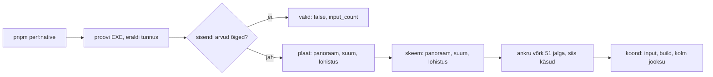

# M2-3-7 · Vastuvõtt, jõudlus ja `v0.8.0`

**Olek:** arhitekti ülevaatuseks · **Rada:** B · **Haru:** `codex/m2-3` (tööpuu `C:/Users/TRUMPIT/.codex/worktrees/bb-m2-3/BB`) · **Alus:** `1acfaf8` · **Plaan:** [M2.3 › Ülesanne 7](../plans/M2-3-skeemi-sumbolid-ja-paigutus.md) ja [vastuvõtt](../plans/M2-3-skeemi-sumbolid-ja-paigutus.md#m23-vastuvõtt-tingimus--tõend) (O6, M2.2b leid 08, [arhitektuuriauditi](../review/2026-11-27-arhitektuuri-audit-cbd4d42.md) leid 06)

## Eesmärk
M2.3 on valmis väljalaskeks `v0.8.0`:
- üks E2E läbib skeemi põhivoo: skeemil lisatud takisti saab hiljem plaadile sama id-ga, tähise vahetus ei muuda ühendusi ega mõõtmisi ja valik on mõlemas vaates sama;
- jõudlusproov on repos ja korratav: see kontrollib enne ajastamist andmete hulka ning salvestab sisendi, kooste tunnuse ja kolm jooksu (leid 08);
- 300 sümboliga skeem ja plaat on Tauris mõõdetud;
- pingenäitude tuletis ei arvuta komponendi liigutusel uuesti (leid 06);
- versioon on 0.8.0, näidisfail `v0.8.0` on skeemipaigutusega ning kasutajal on katse-EXE ja suitsukatse sammud.

Liitmine ja silt on arhitekti töö pärast kasutaja katset ([ARHITEKT §6](../ARHITEKT.md)).

## Loe (ainult need)
Kolm esimest viidet on põhikaustas, teised loe tööpuust (`1acfaf8`).
- `docs/plans/M2-2b-uleandmine.md:1-51` (üleandmise ülesehitus, jõudlustabel ja `v0.7.0` võrdlusalus)
- `docs/tasks/M2-2b-7.md:78-86` (näidisfaili loomine 03 § 9 järgi)
- `docs/plans/M2-3-skeemi-sumbolid-ja-paigutus.md:141-165` (ülesanne 7 ja vastuvõtu tabel)
- `apps/desktop/src/perf/probe.ts:136-268` (praegune proov: loomine, avamine, žestid, käsud ja tulemus)
- `packages/features/__tests__/derived-topology.test.ts:63-123` (tuletise ja täisarvutuse võrdlus)

## Muuda
- **E2E:** uus `apps/web/e2e/m2-3-acceptance.spec.ts` (otsus 1).
- **Tuletis:** `packages/features/measurements/engine/derive.ts` ja `packages/features/__tests__/derived-topology.test.ts` (otsus 2).
- **Jõudlus:** `apps/desktop/src/perf/` (proov, sünteetiline plaat, uus `probe-inputs.ts` ja testid), uus kaust `tooling/perf-native/` ning juurkausta `package.json`-i skript `perf:native` (otsus 3).
- **Paneel:** `packages/features/schematic/ui/pin-function.css` (otsus 4).
- **Versioon:** `apps/desktop/src-tauri/Cargo.toml` ja `Cargo.lock` (otsus 5).
- **Näidisfail:** kaks uut faili ja `packages/domain/src/release-files.test.ts` (otsus 6).
- **Dokumendid:** uus üleandmine `docs/plans/M2-3-uleandmine.md` põhikaustas (otsus 7). `pnpm api`, kui avalik liides muutub.

## Ära puutu
- Failivorming (`format_version`, skeem) ja olemasolevad näidisfailid `v0.1.0`–`v0.7.0`.
- Mootor, domeen ja käsud. Erand on otsuse 2 tuletise sisend; pingenäitude arvutus `pinReadings` ise ei muutu.
- Liitmine, sildid ja Release.
- Kasutaja fotod ja projektid: ehitaja kasutab ainult sünteetilisi.
- Olemasolevate testide ootused. Erand on sünteetilise plaadi generaatori testi hulgad otsuse 3 lisandite võrra.

## Otsused ja liidesed
1. **E2E `schematic_acceptance_end_to_end`.** Sünteetiline projekt luuakse `createBoard`-iga. Enne avamist lisab `storedBoard`-i muster (nagu `m2-3-place.spec.ts`-is) R2 (takisti) ja U1 (IC, 4 jalga) plaadile ja skeemile, ühenduse R2.1–U1.3 ning pingemõõtmise U1.3-l.
   - **Skeemilt plaadile:** Skeem → teegist „Takisti“ → klõps skeemil. Salvestatud dokumendis on uus R1, millel on `schematic` ja puudub `board`; jäta meelde selle `id` ja `schematic.at`. Siis Plaat → loend „Plaadile paigutamata“ → „Paiguta plaadile“ → klõps fotol. Dokumendis on kolm komponenti ja sama `id`-ga R1, millel on `board` ja sama `schematic.at`.
   - **Tähise vahetus:** vali R2 ja muuda kontekstipaneeli väljal „Tähis“ väärtuseks R5. Salvestatud dokumendi `connections` ja `measurements` on täpselt samad mis enne. Plaadil ja skeemil on tähis R5.
   - **Ühine valik:** klõps U1-l plaadil → Skeem: U1 sümbolil on `data-selected="true"` ja kontekstipaneeli pealkiri on „U1“. Klõps R5-l skeemil → Plaat: pealkiri on „R5“ ja U1 pole valitud.
   - Teegi kirje, loendi filtri ja nuppude täpsed nimed võta M2-3-5 koodist.
2. **Pingenäitude tuletis (leid 06).** `pinReadingsDerive.inputs` on `[{ key: 'components', select: (doc) => componentTopology(doc.components) }, 'measurements']`. `componentTopology` tuleb `@pcbk/domain/rules`-ist ja seda kasutatakse nagu `nets`-i tuletises. Arvutus ja skeem jäävad samaks.
3. **Jõudlusproov repos (M2.2b leid 08).**
   - **Asukoht:** M2-2b-5 käivitus- ja koondskriptid tulevad kausta `tooling/perf-native/`. Need on `run-native-probe.ps1`, `serve-native-probe.mjs`, `summarize-native.mjs` ja `native-perf.tauri.json` kaustas `C:/Users/TRUMPIT/.codex/worktrees/bb-m2-2b/BB/output/playwright/m2-2b-5/`. Lähtekoodi tekstiasendused (`change(code, marker, …)`) kaovad: läbivusmõõtmiste lisamine, iga tuletise eraldi ajastus ja taasavamise kontrollid on tavaline kood `apps/desktop/src/perf/`-is ja `probe-timing-plugin.ts`-is.
   - **Käsk:** `pnpm perf:native -- --out <kaust>` ehitab proovi EXE eraldi rakendusetunnusega ja teeb kolm kehtivat jooksu. Igal jooksul on kuni kolm katset ja kehtivuse reegel on sama nagu M2-2b-5-s. Kehtetu jooks salvestub eraldi faili ega lähe mediaani. Koond on `<kaust>/native-acceptance-summary.json`.
   - **Sisendi kontroll enne ajastamist:** `probe-inputs.ts` ekspordib `checkProbeInputs(actual: ProbeInputCounts): { ok: true } | { ok: false; reason: 'input_count'; mismatched: string[] }`. Oodatud on 300 komponenti, 3000 jalga, 1000 rada ja 300 skeemisümbolit (`[data-symbol]` skeemivaates). Mõõtmiste ja nimega võrkude arv tuleb generaatorist. Vale arvu korral lõpetab `measure` enne esimest kaadrimõõtmist ja tulemus on `valid: false`, põhjusega `input_count`. Arvud lähevad tulemuse väljale `input` koos seemne ja akna suurusega.
   - **Kooste tunnus:** koond salvestab välja `build` (commit, kas tööpuu oli puhas, rakenduse versioon ja EXE SHA-256) ning välja `runs` (kolm jooksu täies mahus ja mediaanid).
   - **Sünteetiline plaat:** kõigil 300 komponendil on skeemipaigutus A3 lehel 2,54 mm ruudustikul ja sümbolid ei kattu. Seeme 127 jääb. Plaadi koostis on sama mis `v0.7.0` mõõtmisel, seega plaadi kaadrid on võrreldavad.
   - **Sama ankruga hargnenud võrk:** pärast žestide mõõtmist ja enne käskude mõõtmist lisab proov ühest ankurjalast 50 haru erinevatele jalgadele. Iga haru on `beep.record` „piiksub ja ühenda“, nagu GND kaardistamisel. Enne käskude ajastamist kontrollib `checkProbeInputs`, et ankru võrgus on 51 jalga. Siis mõõdetakse `beep.record` sama ankruga 52. jalale.
   - **Skeemi mõõtmine:** pärast plaadi žeste vahetab proov skeemivaatele. Seal on samad 180 kaadri panoraam ja suum ning ühe sümboli lohistus: vähemalt 110 eelvaate kaadrit, üks `items.translate` `view: 'schematic'` ja `revDelta` 1.
   - **Käsud võrdluseks:** `items.translate` plaadil ja skeemil, `connections.add` ja `beep.record`. Iga tuletise aeg on eraldi (`nets`, `connectionLevels`, `pinReadings` jt).
   - **Piirid** käivad kolme kehtiva jooksu mediaani kohta.
     - Plaadi mediaanid võivad olla `v0.7.0` omadest kuni 3% väiksemad, sest M2-2b-5 jooksude vahe oli kuni 4%. Töölaud ja foto peavad valmima alla 1500 ms. Panoraam peab olema vähemalt 57,2 fps, rattasuum 58,2 fps ja lohistus 40,6 fps.
     - Skeemi piirid tulevad 03 § 7.3 eelarvest 60 Hz ekraanil: panoraam ja rattasuum vähemalt 57 fps, lohistus vähemalt 45 fps.
     - Kui mõni piir ei täitu, ei hakka ehitaja optimeerima. Ta kirjutab tulemuse üleandmisse ja küsib arhitektilt.
4. **Jaotise „Jalgade funktsioon“ vahe** (M2-3-6 ülevaatus). `.pcbk-pin-function` saab sama sisemise vahe nagu komponentide jaotised (`components.css`: `padding: 16px`). Pealkiri, sildid ja valikud joonduvad vasakult ja paremalt väljaga „Tähis“. Tõend on olemasoleva E2E `schematic_pin_function_and_show_on_board` ekraanipilt, mis kopeeritakse faili `output/playwright/m2-3-7/pin-function-light.png`.
5. **Versioon 0.8.0.** `apps/desktop/src-tauri/Cargo.toml` saab `version = "0.8.0"` ja `Cargo.lock`-i `pcbk-desktop` kirje sama väärtuse. Need on ainus versiooniallikas (M1-4-11). `cargo metadata --locked --offline` läbib.
6. **Näidisfail `v0.8.0`** (03 § 9).
   - Failid on `apps/desktop/src-tauri/tests/fixtures/v0.8.0.pcbk` ja `packages/domain/src/__fixtures__/releases/v0.8.0.document.json`.
   - Fail luuakse selle haru kasutajaliidesest sünteetilise fotoga pärast otsust 5, nii et failis on `app_version` `0.8.0`. Tee see samamoodi nagu M2-2b-7 tegi `v0.7.0`.
   - Failis on R1 ja U1 (SOIC-8, jala 3 nimi „FB“, jalg 8 NC), sest seda nõuab üldtest.
   - R1 on plaadil ja skeemil `rot: 90`.
   - Nimedeta jalgadega Q1 (npn) on plaadil ja skeemil, jalgade funktsioon on B → 2, C → 1, E → 3.
   - C2 on ainult skeemil.
   - Dokumendi JSON võetakse sama `.pcbk` faili dokumendist. Suurus ja SHA-256 lähevad üleandmisse.
   - Olemasolevad kaustapõhised testid `every_release_document_migrates_and_validates` ja Rusti `every_release_pcbk_opens_without_modifying_source` võtavad uue faili ise kaasa.
7. **Üleandmine `docs/plans/M2-3-uleandmine.md`** on sama ülesehitusega nagu M2.2b oma:
   - vastuvõtu tabel plaani tingimuste järgi koos tõenditega;
   - automaatsed tõendid;
   - kaks jõudlustabelit: plaat võrreldes `v0.7.0`-ga ja skeem eelarvega;
   - käskude ja tuletiste tabel;
   - teadaolevad piirid;
   - kasutaja suitsukatse.

   Katse-EXE ja vaikekaust on `%TEMP%/bb-m2-3-katse/`, eraldi rakendusetunnusega nagu M2-2b-5-s. Suitsukatse sammud võta allolevast jaotisest.

## Suitsukatse sammud
1. Käivita katse-EXE ja ava oma plaadi projekt, mille tegid `v0.7.0`-ga. See avaneb ja andmed on alles.
2. Vaheta vaade nupuga „Skeem“ või `Ctrl+Tab`-iga. Paiguta loendist „Paigutamata“ 5–10 komponenti: vajuta „Paiguta skeemile“ ja klõpsa lehel.
3. Liiguta komponente hiire ja nooltega, pööra `R`/`Shift+R`-iga ja peegelda `F`-iga. Võta üks samm `Ctrl+Z`-ga tagasi.
4. Kui transistor, diood või LED on kastina, määra kontekstipaneelis „Jalgade funktsioon“ ja vajuta „Salvesta“. Kast peab muutuma õigeks sümboliks.
5. Paremklõpsa komponenti ja vali „Näita plaadil“, siis plaadil „Näita skeemil“. Komponent peab olema mõlemas vaates valitud ja keskel.
6. Lisa skeemivaates teegist takisti ja paiguta see hiljem plaadil fotole.
7. Kas tunned oma plaadi skeemil ära? Mis oli segane või aeglane?

## Tõend
- TS:
  - `pin_readings_skip_moves_and_match_full_rebuild` (`packages/features/__tests__/derived-topology.test.ts`): R1.2-l on pingemõõtmine. Pärast `items.translate`-i ja tähise muutmist jääb `derived.pinReadings` samaks viiteks. Jala 2 asendus (`components.removePin` ja `components.addPin` sama id-ga, uus `uid`) eemaldab näidu. Pärast asendust ja kahte `Ctrl+Z`-d võrdub tuletis täisarvutusega (`setup(structuredClone(doc))`) ja näit on tagasi.
  - `probe_checks_inputs_before_timing` (`apps/desktop/src/perf/probe-inputs.test.ts`, uus): õigete arvudega sisend läbib. Iga arvu (komponendid, jalad, rajad, skeemisümbolid, ankru võrk) eraldi muutmine annab `ok: false`, põhjuse `input_count` ja selle arvu nime `mismatched`-is.
  - `release_document_v080_keeps_schematic` (`packages/domain/src/release-files.test.ts`): kontroll tehakse pärast `migrateDoc`-i, `BoardDocSchema.parse`-i ja `validateDocument`-i. R1 `schematic.rot` on 90 ja `at` on 2,54 kordne. Q1 `pinMap` on `{ B: '2', C: '1', E: '3' }` ja `schematicSymbol(Q1).id` on `npn`. C2-l on `schematic` ja puudub `board`.
- E2e:
  - `schematic_acceptance_end_to_end` (`apps/web/e2e/m2-3-acceptance.spec.ts`): otsuse 1 kolm osa ühes stsenaariumis.
- Tauri: käsk `pnpm perf:native -- --out output/playwright/m2-3-7` annab kolm kehtivat jooksu. Koond on tööpuus `output/playwright/m2-3-7/native-acceptance-summary.json` ja tabelid on üleandmises.
- Rada B täisring: põhikaustast `pnpm bb-review-card M2-3-7` (koos `cargo test`-i ja `pnpm tauri build --debug`-iga) → `ok: true`, `missing: []`.

## Valmis kui
- [x] Testid, `pnpm check`, E2E ja Rusti testid läbivad. Tauri jõudlus on kolme kehtiva jooksuga mõõdetud ja tabelis.
- [x] Muudetud testid on loetletud. Ootuste ainus erand on sünteetilise plaadi generaatori testi hulgad.
- [x] Versioon on 0.8.0, näidisfail `v0.8.0` on lisatud ning selle suurus ja SHA-256 on üleandmises.
- [x] `docs/plans/M2-3-uleandmine.md` on olemas, katse-EXE on `%TEMP%/bb-m2-3-katse/`-is ja ekraanipilt on üleandmises.
- [x] Üleandmine on allpool, kuni 25 rida, koos otsuste kaardi ja failidega väljaspool „Muuda“-loendit. Commit'i sõnumi mustand on `output/commit-msg/M2-3-7.txt` ([kaartide reeglid 9–10](README.md#reeglid)).

## Arhitekti vastus ehitajale (2026-11-28)

**Küsimus:** `schematic_acceptance_end_to_end` läbis alusel `1acfaf8` kõik kolm sammu. Kas E2E võib jääda alusel roheliseks regressioonikaitseks ja kas teostus võib jätkuda kolme RED-tõendi põhjal?

**Vastus: jah.** Vastuvõtu E2E kontrollib M2-3-5 ja M2-3-6 juba ehitatud käitumist, seega on roheline tulemus alusel oodatud. RED on nõutud ainult uue käitumise kohta: pingenäitude tuletis, sisendi kontroll ja näidisfail `v0.8.0`. Kontrollisin testi sisu: see võrdleb sama `id`-d ja `schematic.at`-i, kontrollib `connections` ja `measurements` võrdsust `toEqual`-iga ning valikut mõlemas vaates. E2E-d ei tohi muuta nii, et see kukuks kunstlikult läbi. Pane alusjooksu logi `schematic-acceptance-baseline.log` üleandmisse tõendiks.

## Arhitekti vastus ehitajale: skeemi lohistus (2026-11-28)

**Küsimus:** 300 sümboliga skeemi lohistuse mediaan oli 22,22 fps, piir on 45 fps. Kas aktsepteerida 22,22 fps `v0.8.0` jaoks või jätta jõudluse vastuvõtt eraldi paranduse ootele?

**Vastus: piiri ei langetata ja jõudluse vastuvõtt jääb ootele, kuid parandus tehakse selle kaardi ainsa paranduse ringina.** See on leitud viga, mitte koormuse piir. Plaadi lohistus 300 komponendi ja 3000 jalaga andis 47,06 fps, skeemil on aga ainult 300 lihtsat sümbolit.

Põhjus on `packages/features/schematic/ui/symbol-layer.tsx:104-176`: `SchematicSymbols` joonistab igal eelvaate kaadril uuesti kõik 300 sümbolit koos kõigi kujundite ja jalajoontega. Sümbolil pole `React.memo`-t, kuigi [03 § 7.3](../03-arhitektuur.md#73-kihid-ja-jõudlus) nõuab, et iga komponent on memo-komponent ja sõltub ainult oma andmetest, valikust ja oma eelvaate nihkest.

Parandus. „Muuda“-loendisse lisandub `symbol-layer.tsx`.
- Tõsta sümboli `<g>` eraldi komponendiks `SchematicSymbol = memo(...)`. Propsid on `component`, `selected: boolean`, `dx: number` ja `dy: number`, kus `dx` ja `dy` on haagitud eelvaate nihe või 0.
- Liikumatu sümboli propsid jäävad eelvaate ajal samaks: sama `component` objekt, sama `selected` ja `0, 0`. Siis ei renderdata seda uuesti.
- Joonistus, tähistus ja tabamus ei muutu.
- Uut nimega testi ei lisata. Tõend on `pnpm perf:native -- --out output/playwright/m2-3-7` uus kolme kehtiva jooksu koond ja olemasolevad testid. Vana koond säilib kõrval faili nimega `native-acceptance-summary-before.json`.
- Kui skeemi lohistus jääb ka pärast seda alla 45 fps, ära optimeeri edasi. Kirjuta tulemus koos kaadri ajajaotusega üleandmisse ja küsi.

## Üleandmine

- Tööpuu `C:/Users/TRUMPIT/.codex/worktrees/bb-m2-3/BB`, haru `codex/m2-3`, alus `1acfaf8`.
- Kolm RED-tõendit alusel: `pin-readings-red.log` (tuletise viide muutus), `probe-inputs-red.log` (kontroll puudus), `release-v080-red.log` (näidis puudus). Logid tööpuu kaustas `output/playwright/m2-3-7/`.
- `schematic-acceptance-baseline.log` tõendab alusel 1/1 rohelist E2E-d. Arhitekti vastuse järgi jääb see regressioonikaitseks. Sihitud GREEN: pingenäitude fail 3/3, perf 39/39, väljalaskedokumendid 3/3, kaks brauseritesti 2/2.
- Tauri, kolm kehtivat jooksu (seeme 127, 1280 × 800): plaat 927,6 ms ning panoraam/suum/lohistus 59,01 / 60,00 / 47,06 fps. Skeem 59,34 / 59,67 / **22,22 fps**. Skeemi lohistuse piir 45 fps jäi täitmata. Teised kuus piiri täitusid. Arhitekti otsus ootel.
- Jõudluskoond `output/playwright/m2-3-7/native-acceptance-summary.json` ja käsufaaside tabel `docs/plans/M2-3-uleandmine.md`.
- Otsus 1 → `apps/web/e2e/m2-3-acceptance.spec.ts:145`.
- Otsus 2 → `packages/features/measurements/engine/derive.ts:8`.
- Otsus 3 → `apps/desktop/src/perf/probe.ts:180`, `apps/desktop/src/perf/probe-timing-plugin.ts:48`, `tooling/perf-native/run-native-probe.ps1:120`, `tooling/perf-native/summarize-native.mjs:137`.
- Otsus 4 → `packages/features/schematic/ui/pin-function.css:1`. Ekraanipilt `output/playwright/m2-3-7/pin-function-light.png`.
- Otsus 5 → `apps/desktop/src-tauri/Cargo.toml:3`, `apps/desktop/src-tauri/Cargo.lock:2367`. `cargo metadata --locked --offline` läbis.
- Otsus 6 → `packages/domain/src/release-files.test.ts:60`. Sünteetiline fail loodi 0.8.0 Tauri kasutajaliideses ja taasavati.
- `v0.8.0.pcbk` 61 440 baiti, SHA-256 `ec46daa8cfa7e73a371a9a3b6d7e7c9ba8445f4a25907334fd4f9f296540af81`.
- `v0.8.0.document.json` 5399 baiti, SHA-256 `df294fb6b1a95bf980b20efa1dbcd48265034a4f8a81e69efecc02076b2201ff`. Eraldatud samast projektifailist.
- Otsus 7 → `docs/plans/M2-3-uleandmine.md:5`. Katse-EXE `%TEMP%/bb-m2-3-katse/pcbk-m2-3-katse.exe`, vaikekaust sama, eraldi rakendusetunnus. Kasutaja suitsukatse ootel.
- Olemasolevatesse testifailidesse `derived-topology.test.ts` ja `release-files.test.ts` lisandus kummassegi üks kaarditest. Seniseid sisendeid ega ootusi ei muudetud.
- `git diff --stat` ja uute failide nimekiri vastavad „Muuda“-loendile. Põhikaustas lisanduvad kaardi üleandmine ja `docs/STATUS.md` tööseis. Mustand `output/commit-msg/M2-3-7.txt`.
- Raja B täisring `ok: true`, `missing: []`. Vitest 1782/1782, E2E 51/51, Rust 108/110 (2 vahele jäetud), kaarditestid 4/4 ja Tauri debug-kooste läbis. Raport `output/review-card/M2-3-7-r97tb3/summary.json`.
